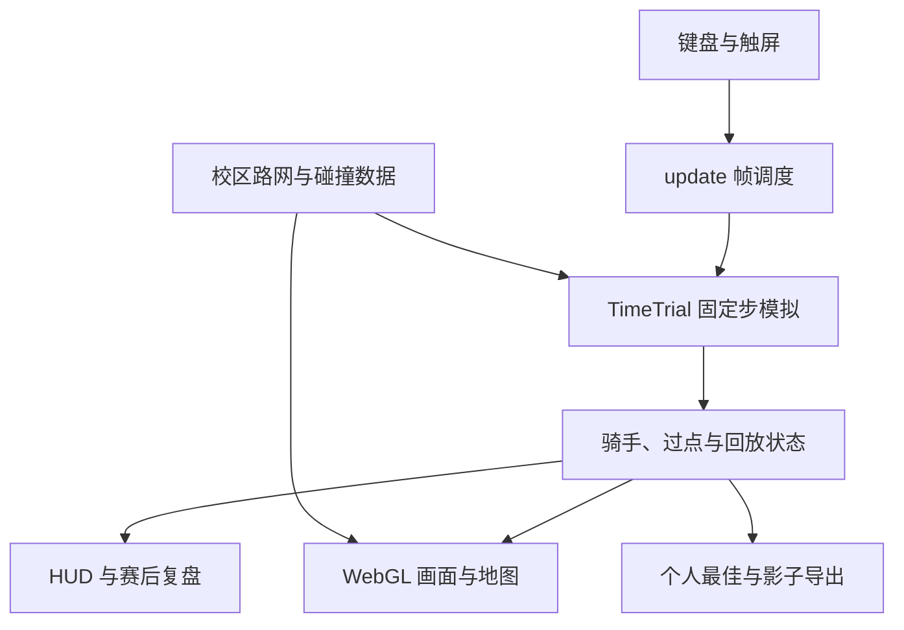
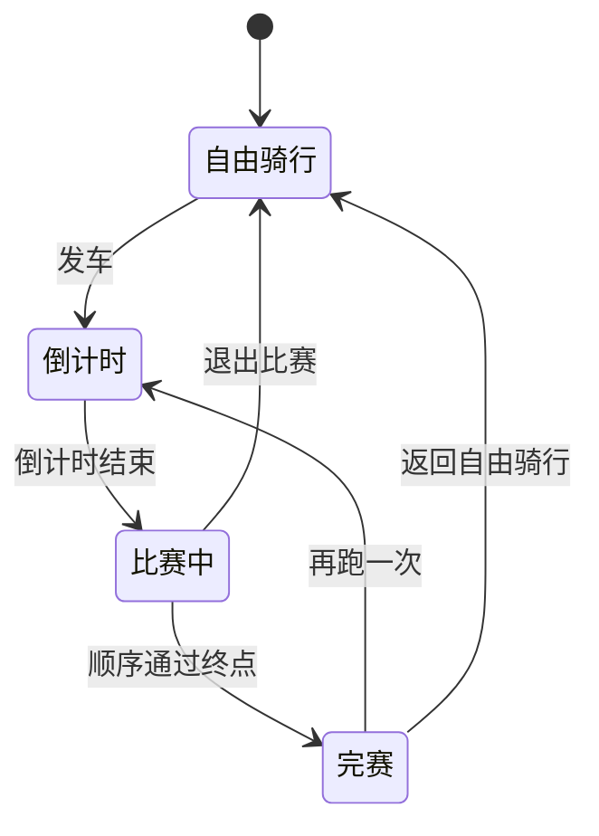

# FORZERO: BUDGET（有限竞速：地贫线）开发工作说明

## 交接基线

**当前发布版为 1.8.6。** 车流可关闭，默认稀疏。单人重开换阵型，周赛按周码复现，联机每轮发新种子。桌面目录 `forzero-budget-1.8.6/`，手机单文件 `forzero-budget-mobile-1.8.6.html`。详见 [1.8.6 车流交接](szu-litchi-dev/ride-update/1.8.6-traffic.md)。

### 1.8.5 历史交付
- **1.8.5 核心变更**：
  - **中文更名、透明 SVG Logo 与版本号升级**：中文正式名更名为 **「有限竞速：地贫线」**（英文 `FORZERO: BUDGET`），主界面 `#intro` 与加载遮罩 `#bootLoader` 使用透明背景斜体三行 `viewBox="0 0 340 150"` SVG 标志，移除冗余标语；当前桌面发行目录为 `forzero-budget-1.8.5/`，手机单文件为 `forzero-budget-mobile-1.8.5.html`，分发镜像位于 `szu-litchi-loop/dist/`，`server.mjs` 存档迁移优先读取 `../forzero-budget-1.8.1/save/player-data.json`。
  - **修复耐力赛上山挡路树木**：将 `qingyun.js` 中侵占 `shunde-endurance` `d=832m` 上山入口路面的树木 `[143, 90.8, 2.45]` 移至 `[137.5, 88.5, 2.35]`（距主环路和上山支线均超过 `6.9m`），保留 `verify-park.mjs` 青云塔遮挡与可视变化。
  - **取消顺峰山过多空气墙并加入落水/落崖强制遣返**：`qingyun.js` 重构 `parkRideable` 开放干地草坪与捷径两侧缓冲带，划分 `parkSurfaceKind`（`paved` / `gravel` / `grass`），并加入 `parkBridgeRailBlocked`、`parkInWater`（湖区多边形 + 桥侧水道）、`parkMountainDropOff`（山地悬崖边界）与 `parkNearestRoad`。当 `moveCyclist` 检测到 `water` 或 `cliff` 危险越界时标记 `rider.hazard`，由 `TimeTrial.step` 在竞赛中触发 `rejoin()`（`+2.0s` 罚时与专属提示）或在自由骑行中传回最近路面。
  - **可选车辆碰撞箱（`preferences.collision` / `room.collision`）**：设置面板 `#settingsCollision` 与联机房间均支持开关（默认关闭）。开启后 `resolveVehicleCollisions()` 基于车辆尺寸（`halfL` / `halfW`）对顺峰山观光车、深大车流及联机对手实施二维投影分离与减速响应。
  - **联机模式支持顺峰山、自定义改车时间、碰撞箱与单人/联机全局风速调节**：`room-rules.cjs` 与 `server.mjs` 新增 `tuning` 房间阶段（`tuningSeconds` `0–180s`，UI 默认 `30s`，服务端 API 缺省 `0` 以兼容旧测试）、`skipTuning` 动作、`collision` 规则、`windSpeed`/`windDir`（`0–15 m/s` + 8 方位风向）与 `shunde` 地图校验；前端新增 `#onlineTuningBanner`、`#settingsDialog` 顶部 `#settingsTuneBar` 及单人/联机通用的地图风速风向调节（`gameplay-170.js` `makeCustomWind` / `activeWind`，周赛保留自带风场），解锁顺峰山站台界面的联机入口。
  - **1.8.5 性能与减面专项优化**：`qingyun.js` 新增 `parkWaterBounds` 湖区 AABB 预剔除、`shunde-mountain.js` 预计算 `shundeHighRiskShortcuts` 段几何与外接框，`moveCyclist`（`build.py`）合并重复的 `parkRideable(x,z,true)` 与 `parkSurfaceKind(x,z)` 判定；`shunde-endur-default` 120 Hz 单步由 `150.38 µs` 降至 `29.71 µs`（**5.06×**），`shunde-lake` 由 `121.30 µs` 降至 `32.07 µs`。`build.py` 同步将 `deciduous`/`palm` 默认开启 `light = true` 并优化 `lamppost`、`londonFence`、`londonLantern`、`londonArch` 及 `londonFront`/`londonTerraceRange`/`portlandBlock` 3 层以上高层细窗棂/窄窗台，静态三角面深大 `689,567 → 432,323`（`-37.3%`）、UCL `426,032 → 302,654`（`-29.0%`）、顺峰山保持 `105,324`；硬件 GPU（`1280×720`）深大起点 `74.8 → 192.0 FPS`、UCL `73.1 → 165.0 FPS`、顺峰山牌坊 `72.4 → 170.6 FPS`，SwiftShader（`987×522`）深大 `24.5 → 30.4 FPS`、UCL `24.2 → 26.6 FPS`，稳态 GL 分配/释放均为 `0 / 0`。

### 1.8.1 历史交付
- **正式品牌**：英文名 **FORZERO: BUDGET**，中文名 **有限竞速：零预算**；原「荔园环骑」保留为深圳大学粤海校区地图及对应赛事名称（不改变地图 ID、`szu-litchi-*` 存储键、`litchi-save` / `litchi-ghost` / `szu-litchi-loop` 协议标识及 `ghostCourseKey()`）。
- **Logo 与加载界面**：[ride-update/build.py](szu-litchi-dev/ride-update/build.py) 与 [bike-workshop.css](szu-litchi-dev/ride-update/bike-workshop.css) 接入纯代码原创 SVG Logo（深黑背景 `#0b0d0f`，斜体竞速排版 `FOR` 白 / `ZERO` `#FF6433` / `:` 白 + `BUDGET` 宽字距 `#FF6433`），同步用于顶栏、主菜单自由骑行面板、WebGL 启动遮罩 `#bootLoader` 与 SVG Favicon。
- **玩家默认名与商标合规**：前端 `DEFAULT_RIDER_NAME`（[ride-update/build.py](szu-litchi-dev/ride-update/build.py)）与联机服务端 `normalizeName`（[online/server.mjs](szu-litchi-dev/online/server.mjs)）空名称回退统一为小写 `player`（清除硬编码个人名称，保留已有本地自定义存档与导出 `.ghost.json` 原始名称）；深大校外与伦敦街景商业商标改写为非侵权近似名称（`Lidl`→`Laodl`、`Tesco Express`→`Lesgo Express`、`Boots`→`Root`、`腾讯大厦`/`腾讯滨海大厦`→`Southizzahut 大厦`/`Southizzahut 滨海大厦`、`McDonald’s`→`McRonald’s`、`Waterstones`→`Waterpebbles`、`Heal’s`→`Heel’s`、`Hilton`→`Hiltown`、`Royal National Hotel`→`Royale National Hotel`、`Wellcome Trust · Gibbs Building`→`Welcome Trust · Gibbs Building`、`Greggs`→`Griggs`、`Oseyo`→`Ohayo`、`Yo Home`→`Yo Dome`、`Wasabi`→`Wasabee`、`Tortilla`→`Tostilla`、`Orchidya`→`Orchidea`、`Treadwell’s Books`→`Treadfast’s Books`、`Russell & Chapple`→`Russell & Chap`、`Decadence Salon`→`Decadence Hair`），保留 UCL、深圳大学与顺峰山公共地标名称。
- **许可协议与根工程文件**：根目录已创建 [LICENSE](LICENSE)（完整 **PolyForm Noncommercial License 1.0.0** 原文、`Required Notice:` 及游戏名/Logo 权利保留声明）、[README.md](README.md)、[CHANGELOG.md](CHANGELOG.md) 与 [.gitignore](.gitignore)。
- **1.8.1 山地与当前发行交付**：顺峰山新增伏波桥侧上山、牌坊侧下山的两条道路与「神步山爬坡赛」「神步山下坡赛」「顺峰山环山耐力赛」（`shunde-endurance`，`1,954.08 m`，牌坊—青云湖—伏波桥—神步山上下坡全闭环），全游戏固定赛道计 `20` 条；同时加入压实碎石独立物理层级（不改变深大/UCL 草地规则）、3 条 `shundeHighRiskShortcuts` 窄切捷径（含山坡地形融合与护栏缺口）、6 辆随高程起伏的环湖观光接驳车（支持 `trafficDraftingAt` 尾流）及顺峰山 10 地标「闪送」模式。当前 1.8.1 桌面发行目录为 `forzero-budget-1.8.1/`，手机单文件为 `forzero-budget-mobile-1.8.1.html`，本开发交接文档为 `FORZERO-WORK-GUIDE.md`，分发镜像位于 `szu-litchi-loop/dist/`（构建后逐字节同步）；内部源码与历史版本目录保持原有名称以兼容构建链、测试脚本与 `1.8.0` 等旧存档自动迁移。电动自行车 · 新国标（[bike.js](szu-litchi-dev/ride-update/bike.js)）在 `motor` 槽位以恶搞「原厂配件」作为默认项（`stock`，`roadSpeed: 25/48`，极速限为 `25 km/h`），同时保留「标准输出」（`standard`，`48 km/h`）及原有爬坡/控弯选项。顺峰山已完成渲染与几何性能优化（[qingyun.js](szu-litchi-dev/ride-update/qingyun.js)、[shunde-mountain.js](szu-litchi-dev/ride-update/shunde-mountain.js)、[build.py](szu-litchi-dev/ride-update/build.py)）：精简公园乔木/棕榈/外围山丘树冠与碎石路缘标记三角面（静态实体三角面由 `168,826` 降至 `101,602`），`parkReflectionBounds` 改为贴合水面的 28m 网格边界，并增加反射 `275m` 距离裁剪与反射/远景单次阴影采样（`shadow1`）。

[1.8.1 山地扩展交接](szu-litchi-dev/ride-update/1.8.1-shunde-mountain.md) · [轻量模型回归 Prompt](szu-litchi-dev/ride-update/1.8.1-mountain-regression-prompt.md)

### 1.8.0 历史交付

**1.8.0 新增顺峰山公园青云湖环线。** 站点旅行支持深大、UCL、顺德任意两站直达。环线长 1,072.74 游戏米，含自由骑行及一场固定计时赛。桌面版、手机横竖屏完圈与稳定帧检测通过，项目负责人保留最终手动回归。

桌面目录为 `szu-litchi-loop-1.8.0/`，发行包为 `szu-litchi-loop-1.8.0.zip`，手机单文件为 `szu-litchi-loop-mobile-1.8.0.html`，源码包为 `szu-litchi-dev-1.8.0.zip`。

路线资料、实地与游戏尺度差异、构建入口、逐段性能与人工检查项见 [1.8.0 顺峰山公园交接](szu-litchi-dev/ride-update/1.8.0-shunfengshan.md)。

### 1.7.0 历史交付

| 交付物 | 工作区位置 |
| --- | --- |
| 桌面游戏 | `szu-litchi-loop-1.7.0/`、`szu-litchi-loop-1.7.0.zip`（8 个运行文件，无 `save/`） |
| 手机单文件 | `szu-litchi-loop-mobile-1.7.0.html`、`szu-litchi-dev/ride-update/szu-litchi-loop-mobile-1.7.0.html` |
| 源码归档 | `szu-litchi-dev-1.7.0.zip` |
| 分发镜像 | `szu-litchi-loop/dist/` |

### 1.7.0 变更摘要

- **全载具数值上调**（`ride-update/build.py` / `bike.js`）：`ebike`（电动自行车 · 新国标）巡航极速 `48 km/h` / 草地 `28 km/h` / 推力 `1.08`、`chair`（电动轮椅）巡航极速 `36 km/h` / 草地 `22 km/h` / 推力 `0.96`、`trail`（越野小摩托）保持 `63 km/h`。改装平衡上限与独立基准同步生效；16 条固定赛道 `ghostCourseKey` 与 `1.6.6` 保持逐条一致。
- **8 项已实现核心玩法**（主要模块：`ride-update/gameplay-170.js`、`medal-dialog.html`、`gameplay-170.css`、`sound.js`、`friend-*`、`online/room-rules.cjs`、`online/server.mjs`、`online-ui.js`）：
  1. **实时滚动差值**（`liveDeltaMs` / `#liveDelta`）：计时赛期间在检查点间持续线性插值显示领先/落后毫秒差，兼容区间单练时间偏移。
  2. **周赛绑定动态环境**（`weeklyEnvironment` / `#windPill`）：按周种子（`[SU]\d-W\d{8}`）确定性绑定天气与风向/风速（`1.0–2.4 m/s`），作用于物理阻力和极速并在界面显示顺/逆/侧风；退出或切回常规赛道恢复玩家设定天气。
  3. **紫牌大师 · 16 赛道勋章总览 · 限定车漆**：金牌之上新增紫牌（`0.90 × 金牌时间`）；顶部「勋章」打开 `#medalDialog` 查看深大 9 场 + UCL 7 场达成与跳转；新增 `amethyst`（紫水晶 · 限定，6 金+或 1 紫解锁）与 `obsidian`（暗曜金 · 大师，1 紫解锁）涂装并在车库/联机服务中校验支持。
  4. **自由骑行「校园闪送 / 地标打卡」**（`CampusCourier`）：深大 10 处 + UCL 10 处已验证可通行地标随机派单（45s 起步 + 按距离动态加时，连单与探索持久化于 `szu-litchi-explorer-1`），预分配静态信标渲染（零稳态显存分配），启动闪送时自动隐藏欢迎浮层避免重叠。
  5. **友人对战「多影子同场群跑」**：清单支持 `.friend-pick` 勾选 2–3 条同赛道兼容影子，点击「多影子群跑」同场渲染（复用 `roomLimbs[0..1]` 与 `#onlineTag0..1`，支持跨校区导入），完赛结算显示击败人数；单人 `.friend-play` 对战完整保留。
  6. **联机新赛制 `random` 与 `triathlon`**：新增三轮盲盒随机种子（`random`，房主轮间自动摇出新种子同步全房）与三轮全载具铁人三项（`triathlon`，自动轮换锁定 `bike → chair → trail`）；计分与不提前结束逻辑在 `online/room-rules.cjs` 与 `online/server.mjs` 服务端强制执行。
  7. **确定性动态路况尾流**（`trafficDraftingAt`）：竞赛使用 `race.elapsed / 1000`、自由骑行使用 `race.freeClock`，与 3D 车流 `trafficNear` 同源计时，自行车紧跟同向车辆 `2.5–14.5m` 触发尾流降阻提速与回能。
  8. **纯代码 Web Audio 动态骑行音效与静音开关**（`updateRideAudio` / `#settingsSound`）：单一复用噪声源驱动风噪、草地/刹车胎噪与滑行飞轮棘轮声，提供「设置 → 动态骑行音效」持久化开关。
- **未加入项目**（依用户确认排除）：未实装发车起跑时机博弈（Launch Timing）及弯道评分回能。
- **1.7.0 自动化验证摘要**：
  - `verify_170_features.mjs`（7 项专项测试：车型数值与 16 赛道 key、实时差值、周赛风场、紫牌与涂装解锁、20 地标 `safeToRide`/`canRideUcl`、车流尾流、联机 `random`/`triathlon` 与新涂装）全部通过。
  - `browser_verify_170.mjs` Chrome 无头实机测试通过（0 报错，桌面 `1280×720`、竖屏 `390×844`、横屏 `844×390` 截图布局验证通过，闪送及多影子稳态 `glBuffers` 分配/释放均为 `0/0`）。
  - 全量既有回归（`slopes/verify`、`london/verify`、`verify-ucl-frontages`、`verify-map`、`verify-collision-index`、`verify-route-guidance`、`verify-weekly`、`verify-friend-ghost`、`verify-save-recovery`、`ride-update/verify`、`online/verify`、`online/verify-version-folder`（`1.7.0` 与 `dist`）、`verify-1.5.0`、`verify-1.6.0` 含 `--maps` 稳态 `0/0` 与 `--mobile-save`、`online/browser --mock` 及 `online/browser` 四人 WebRTC、`friend-qa/browser`、`week-qa/browser`）全部通过。
  - 按用户要求跳过独立 Hydrogen 模型深度调试环节。
  - **移动端起步触屏修复**（`bike-workshop.css` / `build.py`）：改为仅在 `#callout[data-mode="paused"|"done"]` 时隐藏 `.touch`，倒计时（`count`）与发车前 610ms「出发」（`race`）保留触屏按键并设置 `#callout` 为 `pointer-events:none`（横屏短屏略上移至 `top:42%`），支持起跑前提前按住加速。已通过 `verify_mobile_touch_launch.mjs` 竖屏 `390×844` 与横屏 `844×390` 实机触屏起步验证。

### 1.6.6 对照基线

**1.6.6 为上一正式发布版。** 桌面目录为 `szu-litchi-loop-1.6.6/`，发行包为 `szu-litchi-loop-1.6.6.zip`，手机单文件为 `szu-litchi-loop-mobile-1.6.6.html`，源码包为 `szu-litchi-dev-1.6.6.zip`。

- 启动器首次迁移时按 1.6.5、1.6.4 至 1.5.0 查找同级存档。遇到损坏的历史 JSON 跳到下一份有效存档。当前目录的存档损坏时，读取和写入均返回 409，保留原始文件并在设置中报告错误。关闭应用壳前等待已入队的写盘。
- 桌面自动保存仅在读入磁盘存档后启动。读取 IndexedDB 失败或找不到完整影子时，上传的 `friends: null` 表示保留磁盘记录，`friends: []` 仍表示确实是空库。浏览器备份导入会拒绝无效的 `storage` 并显示写入失败，个人数据可在影子暂时不可读时导出。
- `verify-save-recovery.mjs` 覆盖历史坏档回退、当前坏档保护、影子库读取失败和无效导入。Chrome 手机模拟用 `verify-1.6.0.mjs --mobile-save` 检查 390×844 竖屏与 844×390 横屏的离线备份导入。走线和手动回归赛道脚本沿用既有规则。

### 1.6.5 对照基线

**1.6.5 仅更新版本标识和发行包。** 下列 1.6.4 回归记录为原交接记录。

回归测试由项目负责人手动执行。功能边界以交接说明的明确要求为准，文档未列出的行为沿用现版实现，尤其是检查点判定与手动回归。

| 交付物 | 工作区位置 |
| --- | --- |
| 桌面游戏 | `szu-litchi-loop-1.6.5/`、`szu-litchi-loop-1.6.5.zip` |
| 手机单文件 | `szu-litchi-loop-mobile-1.6.5.html` |
| 源码 | `szu-litchi-dev-1.6.5.zip` |
| 最新分发镜像 | `szu-litchi-loop/dist/` |

构建入口为 `szu-litchi-dev/london/build.py` 与 `szu-litchi-dev/ride-update/build.py`。桌面脚本、样式、服务端和启动器与 1.6.4 逐字节一致。桌面及手机 HTML 的差异限于版本文字。解压源码归档可重建全部 12 层并与发布文件核对。

### 1.6.4 对照基线

当前交接为 **1.6.4 镜头防抖、友人对战更名与周赛检查点反馈修复定版**（已完成 6,016 组相机连续稳定审计、104 周种子直道门位与过点反馈回归、16 条固定赛道 `ghostCourseKey` 一致性核验、全量回归及桌面/手机端 3D 截图验收）。游戏目录为 `szu-litchi-loop-1.6.4/`，`szu-litchi-loop/dist/`、打包归档 `szu-litchi-loop-1.6.4.zip` / `szu-litchi-dev-1.6.4.zip` 及单文件移动版 `szu-litchi-loop-mobile-1.6.4.html` 均已逐字节同步；深大外围与 UCL 建模变更及依据另见 [1.6.1 迭代交接](szu-litchi-dev/ride-update/1.6.1-iteration.md)。以下保留 1.6.3、1.6.2、1.6.1、1.6.0 与 1.5.0 对照基线。

**荔园环骑 1.6.4** 在 1.6.3 基础上彻底解决三项实机问题：消除 `avoidWall()` 离散 5 步采样反馈环导致的开赛前/倒计时/贴墙镜头抽动、将全端「友人榜 / 本周友人榜」更名为「**友人对战 / 本周友人对战**」，并修复周赛检查点压弯、过点缺少即时反馈与默认无声的问题；完整保留 16 条固定赛道、种子系统 v2（`S2-*` / `U2-*`）、自行车工坊、伏身破风与起身摇车、时段天气、高风险近路、本地 `save/player-data.json` 持久化与 `--app` P2P 好友联机。

| 要找的东西 | 工作区位置 |
| --- | --- |
| 工作目录 | 仓库根目录（`./`） |
| 1.6.4 当前版本文件夹 | `szu-litchi-loop-1.6.4/`（含 `index.html`、`style.css`、`game.js`、`server.mjs`、`room-rules.cjs`、`启动游戏.bat`、`README.md`、`sound/README.txt`） |
| 1.6.4 手机单文件版 | `szu-litchi-loop-mobile-1.6.4.html`（内置完整游戏与竖/横屏触屏自适应，直接发至手机浏览器离线游玩） |
| 分发目录与归档 | `szu-litchi-loop/dist/`、`szu-litchi-loop-1.6.4.zip`、`szu-litchi-dev-1.6.4.zip`（与 `szu-litchi-loop-1.6.4/` 发行文件逐字节一致） |
| 旧版本归档和性能对照 | `szu-litchi-loop-1.6.3/`（含 `mobile-1.6.3.html`）、`szu-litchi-loop-1.6.2/`（含 `mobile-1.6.2.html`）、`szu-litchi-loop-1.6.1/`（含 `mobile-1.6.1.html`）、`szu-litchi-loop-1.6.0/`、`szu-litchi-loop-1.5.0/`、`szu-litchi-loop-1.4.0/`、1.0.0 至 1.3.2 的独立 HTML |
| 最新构建产物和可搜索脚本 | `szu-litchi-dev/ride-update/release/`、`szu-litchi-dev/ride-update/game.js` |
| 联机服务、启动器与部署 | `szu-litchi-dev/online/server.mjs`、`szu-litchi-dev/online/start-game.bat`、`szu-litchi-dev/online/README.md` |

接手时先复现玩家描述的地图、赛事、车型和操作，再到合并脚本搜索函数名。根据构建链定位最后写入这段逻辑的源码，修订后从该层向下构建，跑对应的回归和浏览器测试。本项目的发布是把验收后的版本文件放在用户电脑上。

## 架构与源码所有权

### 构建链

每一层的 `build.py` 读取上一层的 HTML，将内联 JavaScript、局部 HTML 和样式段替换后写出新产物。较新的构建脚本用 `js()`、`js_span()`、`html()` 定位文本锚点，`replace_once()` 要求单次命中。遇到锚点错误时，先对照上一层产物和该层补丁，修正锚点或变更位置。`game.js` 和该层的完整 HTML 都由构建生成，持久修改应写在注入片段或构建脚本里。

下列目录都在 `szu-litchi-dev/` 中，箭头表示上一层的构建产物供下一层读取。

1. `performance` → `gameplay` → `street-riding` → `campus-map` → `endurance` → `road-junctions`
2. `garage` → `architecture` → `bloomsbury` → `slopes` → `london` → `ride-update`

从 `performance/baseline.js` 与 `rounds/page.html` 可重建这条链。`performance` 输出 `compiled.html`，后续各层输出 `szu-litchi-loop.html`。1.0.1 和 1.1.0 都已从隔离副本重建全部 12 层，并核对发布版的 SHA-256。1.1.0 的友人榜和本周友人榜入口位于末端 `ride-update` 层。

| 修改目标 | 从哪些源文件开始查 |
| --- | --- |
| 深大路网、校门、场地 | `campus-map/campus-plan.js`、`campus-map/entrances.js`、`campus-map/grounds.js`、`road-junctions/public-roads.js`、`road-junctions/bridges.js` |
| 深大最近的入口退界、球场、外围公园与城景赛道 | `ride-update/yuehai-setbacks.js`、`ride-update/tennis-courts.js`、`ride-update/shenzhen-perimeter.js`、`ride-update/shenzhen-courses.js`、`ride-update/build.py` |
| 杜鹃山和深南立交 | `slopes/terrain.js`、`slopes/courses.js`、`slopes/flyover-race.js`。耐力赛最后一轮改线、公园铺装分类与版本号在 `ride-update/build.py` |
| 伦敦道路、楼体位置、正门与铺装 | `london/layout.js`、`london/front-lodges.js`、`london/infill.js`、`london/street-ground.js`、`london/scene.js` |
| IOE、UoL Senate House 与学生中心 | `london/layout.js` 管位置、尺度和碰撞部件，`london/architecture.js`、`london/student.js` 管模型细节 |
| 伦敦商铺、公交和地铁 | `london/shops.js`、`london/transport.js`。地图图例与投影在 `london/chart.js` |
| 伦敦固定赛、过点宽度和引导 | `london/races.js`、`london/race-geometry.js`。最终检查点逻辑在 `ride-update/trial-progress.js` |
| 通用引导、计时和回归 | `ride-update/route-progress.js`、`ride-update/trial-progress.js`，以及 `ride-update/build.py` 对 `TimeTrial` 的后续替换 |
| 周赛、路网和赛道生成 | `ride-update/seed-roads.js`、`ride-update/seed-races.js`、`ride-update/seed-ui.js`、`ride-update/seed-dialog.html` |
| 载具、改装和设置 | `garage/profile.js` 和 `garage/vehicle-models.js`、`rounds/settings.js`。平衡参数、恢复老配置和车库的最新替换在 `ride-update/bike.js`、`ride-update/build.py` |
| 影子数据与交互 | `ride-update/friend-ghost.js`、`ride-update/friend-ui.js`、`ride-update/friend-dialog.html`。记录采样、车种锁定和跨图加载接在 `ride-update/build.py` |
| 友人对战与影子归档 | `ride-update/friend-board.js` 管筛选和排名，`ride-update/friend-store.js` 管 IndexedDB 事务，`ride-update/friend-board.css` 管榜单布局。`seed-dialog.html` 和 `seed-ui.js` 提供本周友人对战入口 |
| 实时好友房与主机模式 | `ride-update/online-ui.js` 管房间、大厅换图/换种/换车型/换天气、房内车库同步、本地自动开服/关服控制、房主 IP 解析、跨源建连和发车，`online-rtc.js` 管 P2P 建连、延迟探测、尾流判定、实时排位与姿态插值，`online-dialog.html`、`online.css` 管界面。`online/server.mjs` 与 `online/room-rules.cjs` 管本地应用壳（`--app`）、按需启停房主监听、`/sound/` 托管、静态资源托管、CORS、网卡地址发现、信令、房主、轮次和排名，`online/start-game.bat` 管 Windows 无黑框一键启动 |
| 时段天气、音效、近路、复盘单练与本地存档 | `ride-update/atmosphere.js` 管正午/黄昏/夜骑/雨天配色与湿地物理及 2D 雨丝层，`ride-update/sound.js` 管可选自定义 `sound/` 加载与内置 Web Audio 轻量提示音兜底，`ride-update/shortcuts.js` 管杜鹃山坡脚与 IOE 西侧窄切线与护桩，`ride-update/practice-review.js` 管俯视图走线对比、侧栏分段差值与随时区间单练，`ride-update/save-sync.js` 管 `save/player-data.json` 自动同步及导出/导入备份 |
| 自行车工坊与姿态 | `ride-update/bike-workshop.js` 管预设、外观字段、能力条和姿态；`bike-models.js` 管几何和 LRU；`bike-workshop.css` 管工坊与 HUD；`build.py` 接入 120 Hz 物理与绘制 |
| 版本文件夹打包 | `ride-update/build.py` 输出多文件目录 `ride-update/release/` 与 `ride-update/game.js`，游戏文件同步至 `szu-litchi-loop-1.6.0/` 与 `szu-litchi-loop/dist/` |
| 渲染、静态分块和碰撞索引 | `performance/build.py`、`performance/scene-chunks.js` 为上游，`ride-update/build.py` 和 `ride-update/collision-index.js` 为 1.0.1 增量 |

### 浏览器如何跑一帧

`run()` 默认准备深大地图，初始化界面与 WebGL 2，上传场景后通过 `requestAnimationFrame` 调用 `update(now)`。`activeCampus` 决定当前地图，单个 `race`（`TimeTrial`）持有本次骑行、参赛车型、当前赛道和计时。`buildRidingScene()` 准备碰撞和 CPU 侧几何，`uploadRidingScene()` 创建 GPU 网格和静态阴影。



- `queueDrive()` 记录输入状态和 `performance.now()` 时间轴上的时间戳。`driveAt()` 按模拟步边界消耗队列，`TimeTrial.advance()` 以 **120 Hz** 固定步长推进。渲染帧率和物理步长各自控制，帧间累计时间可以补算多个模拟步。
- `TimeTrial.step()` 调用 `moveCyclist()`，更新速度、转向、位置和路面状态。比赛中再计算路线引导、弯道表现、过点和回放采样。HUD 从 `race` 读状态，赛道装饰由 `courseDecor()` 按赛事或耐力赛当前赛段缓存。
- `drawScene()` 用骑手姿态和 `rideCamera()` 构造画面，`renderer.draw()` 绘制几何、阴影和影子。`renderCampusMap()` 复用 Canvas 2D 底图，再叠加动态位置。地图、赛道、缩放、视图和像素比变化会触发底图重建。
- 画质自动档用帧时间调整抗锯齿和内部渲染分辨率。帧耗时较高时先降低自动抗锯齿级别，再按设定降分辨率。`graphicsScale()` 按画质档、像素比和预算决定画布尺寸。

### 核心数据与单位

| 数据 | 结构与用途 |
| --- | --- |
| 校区 | `szu`、`ucl`。`campuses` 提供名称、车站与抵达坐标，`activeCampus` 决定路面、碰撞、赛事与俯视图入口。 |
| 道路与路线 | 路径 `path.rows[]` 含 `p` 和沿线 `distance`。`section()` 截取路段，`joinTrack()` 拼接，`along()` 按里程插值，`courseFrame()` 给出位置、前向 `f` 和横向 `side`。 |
| 赛事 | `event` 含 `campus`、`id`、`path`、`length`、`gates[]`、`markers`、发车位和朝向。种子赛另有 `seed`，耐力赛另有 `stages`。每个检查点带 `distance`、`p`、`f`、`side`、可通行宽度和相对高差 `rise`。 |
| 骑手 | `rider.position=[x,y,z]`，XZ 为水平面，Y 为高度，单位为游戏米。`heading` 为弧度，`speed` 为米每秒，界面乘 3.6 显示 km/h。`travel` 是带方向的累计行进距离，路线估计里程存在 `routeAnchor`。 |
| 三套时间 | 模拟步长和倒计时用秒，比赛成绩、分段和回放时间戳用毫秒。键盘队列用浏览器单调时钟，周赛日期用设备本地日历。 |

## 功能级说明

### 场景、通行和切换

场景位置同时服务模型绘制、俯视图、碰撞和赛事。深大用 `geo()` 转游戏坐标，伦敦用 `londonPoint()` 和本地街区坐标。移动校门、建筑或店铺时，同时核对路面网格、地块或设施碰撞、地图标注和经过此处的赛道。结合校方地图和街景定位，沿实际可骑的两侧进入和驶出。立业门、本源设计研究中心附近、原体育场、UCL 正门和 IOE 是已有反馈的重点复查位置。

| 判定 | 责任 |
| --- | --- |
| `surfaceAt()`、`pavedGroundAt()`、`uclSurfaceAt()` | 给车辆判定铺装与松软路面，影响抓地、滚阻和限速。贴图、路面几何和物理分类分别可查。 |
| `safeToRide()`、`canRideUcl()` | 深大检查边界、湖面、建筑和树干，允许在符合条件的校外公路骑行。伦敦检查地图边界、建筑部件、设施和树干。`moveCyclist()` 另有上下立交和碰撞后沿边滑行的处理。 |
| `buildingAt()`、`uclBuildingAt()`、`avoidWall()` | 建筑查询和相机避墙共用建筑候选。相机从骑手附近向目标镜头取样，按带高度的建筑判定找到最近的合适机位。 |
| `rideElevation()`、`hillGrade()`、`flyoverAt()` | 地形和桥面高度参与骑手位置、坡度动力、相机、回放及立交检查点。 |

自由骑行时，车站按钮远处先把玩家带到本站，站旁再切换校区。跨图影子沿用 `pendingCampus` 和 `completeTravel()`，带上待导入的影子。切换先构建目的地，重建赛道并校验影子，再更新渲染资源、界面、赛事和相机。

### 骑行、赛事和近路

| 玩家操作 | 代码入口与结果 |
| --- | --- |
| `WASD`、方向键、触屏、`Shift` | `initInput()`、`queueDrive()`，向物理层提供油门、刹车、转向和自行车冲刺布尔状态。 |
| 「自由骑行」和 `M` | `enterFreeRide()` 清除当前对战并进入自由骑行。`M` 开关俯视图。 |
| 「开始计时赛」或 `R` | `startTrial()` 经 `TimeTrial.start()` 生成发车状态，倒计时 360 个模拟步。 |
| `P` 和 `Esc` | `P` 切换暂停，`Esc` 开关设置。打开设置或把浏览器切到后台会暂停比赛推进。 |
| `F` 或设置里的「回到赛道」 | `recoverTrial()` 调用 `TimeTrial.rejoin()`，在上一道与下一道之间选回归点，加 2 秒，保留已通过的检查点。 |



暂停由 `race.paused` 单独管理。终点和沿途检查点属于同一有序数组，`nextGate` 指向当前待过的线。`recordCheckpoint()` 检查骑手在单步前后是否向前穿过该线且落在横向有效区间，按穿线比例插值出分段时间。立交还核对桥面高度，避免从桥下记到桥上成绩。

`guideProgressAt()` 仅估算上一点到下一点之间的路线位置，`onGuide` 和 `routeAnchor` 给引导、刹车建议和弯道评分使用。绕行或抄近道期间照常计时，下一检查点继续有效。是否回归由玩家决定。耐力赛的 `stages` 供界面和分段展示，完赛仍由逐个检查点推进。

| 地图 | 固定赛事 ID |
| --- | --- |
| 深大粤海 | `libraries` 双馆穿行，`lakes` 双湖冲刺，`teaching` 汇文技术赛，`ring` 粤海环校赛，`endurance` 荔园环城耐力赛，`dujuan-climb` 杜鹃山爬坡赛，`dujuan-descent` 杜鹃山下坡赛，`lixiang-park` 荔香公园城景环线，`canghai-tech` 白石科创城际冲刺 |
| 伦敦 Bloomsbury | `quad-sprint` 主庭院冲刺，`square-circuit` 双广场技术赛，`bloomsbury-endurance` 布卢姆斯伯里耐力赛，`medical-chicane` 医学区折返冲刺，`st-pancras-squares` 圣潘克拉斯与三广场，`store-museum-gp` 商街书店与大英博，`alleyway-slalom` 学院穿堂速通赛 |

### 载具与改装

`vehicleChoices` 定义 `bike` 自行车、`ebike` 电动自行车、`chair` 电动轮椅、`trail` 越野小摩托。四种载具都能参赛，按车型保存个人最佳和选择基准影子。后三种的铺装标称上限依次为 25、10、63 km/h。倒计时和比赛期间锁定改装，影子对战使用对手的车型。

`buildBike()` 把轮胎、齿比、刹车合并为自行车物理参数。长齿比提高长直道极速，短链提高低速、坡起和出弯推力，越野胎改善草地抓地、滚阻和入草减速。刹车套件决定直线制动和带刹转向的取舍。平衡改动用相同入口速度比较直道、短坡和混合路面，检查某配置的优势能在适合它的具体路段出现。

### 周赛和种子赛

菜单入口为「每周挑战 / 种子」。`readSeedCode()` 将输入去首尾空格并转大写，校验校区前缀与 `seedVersion`（1.6.2 起升级为 `2`）。短码 `326` 在深大规范为 `S2-326`，在伦敦规范为 `U2-326`。周赛使用 `S2-WYYYYMMDD` 或 `U2-WYYYYMMDD`，日期是设备本地那一周的周一。`weeklySeed()` 读取本地年月日，再用 UTC 日历运算求周一日期。弹窗打开期间会在下一个本地周一零点刷新，按钮可复制完整码。

`makeSeedCourse()` 为当前地图延迟建立命名路网（1.6.2 起深大纳入荔香公园、深南大道与白石路外围弧段并通过 `cityAccess` 自动解锁校外通行，UCL 纳入 1.6.1 全部医学区、教堂/北正方形广场与穿堂窄道）。`seedRandom()` 从完整种子码初始化随机序列，`searchSeedTrack()` 用有上限的回溯搜索拼接道路，校验长度、铺装与通行、重复靠近、急转和坡度，再生成有序检查点。周赛搜索失败会用同校区的 `326` 尝试预备路线，公开赛道 ID 仍使用原周码。`seed-ui.js` 与 `friend-board.js` 会自动清理/隔离从 1.6.1 迁移过来的旧 `S1-`/`U1-` 种子，旧版种子影子仍可查看和移除。修改路网、可通行性或生成规则时，应用同一批种子重新核对路线和影子布局。

### 友人影子和存档

完赛后从结果面板导出 `.ghost.json`，可拖到游戏窗口或在「友人对战」里选择文件。`TimeTrial.finishAt()` 记录 `lastRun` 供导出，个人最佳另按更快成绩更新。导入用 `readGhostFile()` 校验文件和数值，`loadFriendGhost()` 还原对应赛事并比对布局摘要和分段数，`activateFriendChallenge()` 把结果装入 `race.opponent`。普通参赛的参考从个人最佳、车型基准中选取，对战时好友影子优先。回放与赛后差距以本次比赛时间轴为准。

| 文件字段 | 影子格式 v1，适用于游戏 1.0.1 和 1.1.0 |
| --- | --- |
| `format`、`version` | `litchi-ghost`、数字 `1`。一次导入一个文件，最大 2,200,000 字节。 |
| `course` | `campus`、`id`、`seed`、`layout`。固定赛的 `seed` 为 `null`，种子赛 ID 为 `seed-<规范码>`。`ghostCourseKey()` 对路径和检查点几何量化后计算 8 位十六进制布局摘要。 |
| `rider` | `name`、`vehicle`、`paint`。骑手名归一化后用于游戏标签，最多 12 个 Unicode 码点，车漆使用现有 ID。 |
| `run` | `time` 总时长、`splits` 累计过点毫秒、`samples` 姿态数组、`corners` 弯道评分。分段按点顺序增加，末段和末个样本应与总用时一致到 1 毫秒内。 |
| `samples[i]` | `[t,x,y,z,heading,speed,travel,steer]`。`y` 保存相对地形的高度，`replayAt()` 恢复地形高度，按比赛时间二分定位并插值，并处理手动回归造成的位移跳变。最多 8,200 个样本，长跑达到上限后会稀疏采样。 |

| `localStorage` 键 | 数据与读取顺序 |
| --- | --- |
| `szu-litchi-driver-1` | `{name,vehicle,paint}`，载入时校验载具和车漆 ID。 |
| `szu-litchi-bike-1` | `{tyres,gears,brakes}`，历史存档缺刹车时使用 `stock`。 |
| `szu-litchi-display-1` | `{resolution,aa,ghost,brakeLine,weather}`，缺失或无效时回退默认值（`weather` 默认 `'day'`）。 |
| `szu-litchi-last-seed-<campus>` | 各校区上一次在种子弹窗中确认的完整种子码。 |
| `szu-litchi-online-host-1` | 联机弹窗中上一次填写的房主地址（IP 或域名），供跨源直连复用。 |
| `checkpoints:<recordKey>` | 每个赛事和车型的个人最佳。如 `checkpoints:seed-race:U2-326:trail` 和 `checkpoints:london-bloomsbury-2:quad-sprint`。`loadBest()` 依次读新键、无前缀键、自行车的旧赛事键，并验证检查点数及轨迹。 |

游戏版本号由 `ride-update/build.py` 的 `release_version` 设置。`seedVersion` 管同种子生成规则，`GHOST_VERSION` 管文件格式，赛事成绩键和 `ghostCourseKey()` 管路线布局兼容性。更新赛道、回放结构或存档前，分别检查这几类版本的影响。排查旧成绩时先用玩家原有本机入口复现，浏览器存储会受打开入口和浏览器配置影响。

### 1.1.0 友人对战（原称友人榜）

自由骑行和完赛时可打开「友人对战」，默认显示当前地图、赛道和参赛车型。「每周挑战 / 种子 → 本周友人对战」用 `weeklySeed()` 选中当前地图的本周完整种子码。历周导入过的成绩可通过对应种子继续查找。玩家也可以导入自己的完赛影子参与同组比较。

- `friend-board.js` 只读取成绩索引。它先按校区、赛事 ID 和车型筛选，再按布局摘要分表，每组按实际用时从短到长排列。布局已知过期时可移除成绩，选择已归档的影子时会重新校验布局和检查点数。
- IndexedDB 数据库 `szu-litchi-friends` 的结构版本为 `1`。`scores` 保存自增 `id` 与 `campus`、`courseId`、`seed`、`layout`、`name`、`vehicle`、`time`。`replays` 以同一 `id` 保存规范化的影子 JSON。`result` 索引用成绩元数据找候选，再对比完整回放来去重，同名的不同骑行仍各有成绩。写入与移除都在同时覆盖两个对象仓库的事务中完成。
- 新导入先验证文件，再由 `loadFriendGhost()` 验证当前赛事。跨图时 `pendingCampus.ghost` 带回放，`pendingCampus.archive` 表示校验通过后需要归档。恢复已保存的影子走相同载入路径。数据库写入失败时，弹窗提示保存结果，返回后仍可挑战已经载入的影子。

### 1.2.0 P2P 好友房

房主从当前固定赛或种子赛开房，房间码和 `#room=` 邀请链接可供 2–4 位玩家加入。来宾可自动跨校区载入赛道。所有人准备后由房主发车，每轮全员完赛、退出或超时后结算。房内使用自行车，退出时恢复原车型和配置。`F` 回归沿用原来的 2 秒罚时。联机成绩用于本房排名，完赛影子仍可导出。

| 模块 | 职责与边界 |
| --- | --- |
| `online/server.mjs` | Node 内置 HTTP。`POST /online/rooms` 建房或入房，SSE `events` 推送房间状态与 WebRTC 信令，`POST command` 接收准备、发车、完赛和退出操作。成员凭据与房间元数据只在进程内存里。SSE 中断给 15 秒重连窗口，退出后依次转移房主，单轮墙上时钟上限 20 分钟。 |
| `online-ui.js` | 校验 `campus`、`id`、`seed` 和 `ghostCourseKey()`。跨校区经 `pendingCampus.online` 复用地图构建和切换。`syncOnlineClock()` 从三次 HTTP 测量选最短往返，`tickOnline()` 把服务端 `goAt` 映射到浏览器单调时钟并启动原有 3 秒倒计时。比赛仍由本机 `TimeTrial` 以 120 Hz 计时和判定过点。联机成绩不更新离线个人最佳。 |
| `online-rtc.js` | 2–4 人全互连，四人房共 6 条连接。每条使用无需重发的无序 DataChannel。双方按成员 ID 决定谁发 offer，ICE 信令经房间服务交换。骑行按 15 Hz 发送 32 字节姿态。直连时主机不承担骑行姿态流量。 |
| 服务器排名 | BO1 按最短用时。BO3 按胜场，最多三轮，提前锁定胜场时结束。联赛五轮，单轮从人数向下给分，未完赛 0 分。BO3 同胜场时比较积分，联赛同积分时比较胜场，再比完赛轮数和用时总和。服务器按客户端上报的本机成绩结算好友赛。公开周榜仍需服务端复算。 |

姿态包按 DataView 默认大端编码。偏移 0、2、4 各为 `uint16`，分别存轮次、序号、回归编号。偏移 6 为 `int16` 转向，除以 32767 得归一化值。偏移 8 开始的 6 个 `float32` 是 X、Y、Z、朝向、速度、累计距离。接收端按轮次和序号过滤过期包，125 毫秒缓冲插值，最多外推 160 毫秒，回归编号变化时清空旧轨迹。3D 视图复用影子网格，俯视图绘制同一组姿态。四人房每人向另外三人合计发送约 1.44 KB/s 姿态净载荷。公网直连率和 TURN 中继量需用真实异网样本测量。

部署见 `szu-litchi-dev/online/README.md`。部署包中的 `server.mjs` 默认提供同目录 `index.html`，同源代理整个站点与 `/online/`。单 Node 进程运行，无 npm 依赖。未配置 TURN 时尝试直连。提供 TURN 时，服务端可用共享密钥签发短期凭据。

### 1.3.0 文件联机（历史，1.4.0 已移除）

1.3.0–1.3.2 曾提供本地 HTML 互传 `.litchi-room.json` 邀请与应答文件的星形中转房（已由 1.4.0 的版本文件夹房主主机与直连 IP 架构替代，历史代码保留在 `szu-litchi-loop-1.3.x.html` 中）。

### 1.3.1 网络延迟

`online-rtc.js` 在已连接的 `ride` DataChannel 上每秒尝试发送一个 5 字节探测包。首字节为消息类型 `1` 或 `2`，后四字节为大端 `uint32` 序号。双方用 `performance.now()` 计算探测发出到收到同序号应答的往返时间。挂起探测最多等待 2.5 秒，3.5 秒前的样本到期。旧版客户端可继续交换姿态，缺少应答时延迟显示 `—`。

`online-ui.js` 在房间名单显示各直连的样本，骑行计时面板显示本机与已测量骑手之间的最高直连延迟，退出房间后隐藏。

### 1.3.2 联机改装

好友房通过 `setOnlineCourse()` 选择自行车。进房时，`session.originalBike` 保存玩家当时的车库配置，随后把它交给 `race.bike`。`TimeTrial.start()` 每轮用该配置调用 `makeCyclist()`，轮胎、齿比和刹车沿用 `moveCyclist()` 的本机物理。赛前去车库调件，房间内保留入房配置。房间面板「我的自行车」显示三个配件名称。离房后恢复入房前的车型。

### 1.4.0 版本文件夹与房主主机直连

为突破纯单文件 HTML 无法监听端口的限制，并解决不同房主 IP 导致的浏览器 `localStorage` / IndexedDB 存档隔离问题，1.4.0 引入标准版本文件夹架构、跨源 IP 直连，并**移除 1.3.0 的文件联机（`manual-room.js`、`manual-mock.js` 及相关界面按钮）**，统一为全互连 WebRTC 好友房：

- **拆分版本文件夹**：`ride-update/build.py` 统一提取 `<style>` 与 `<script>` 生成多文件目录 `ride-update/release/`（同步交付至 `szu-litchi-loop-1.4.0/` 与 `szu-litchi-loop/dist/`），包含 `index.html`、`style.css`、`game.js`、`server.mjs`、`room-rules.cjs`、`启动游戏.bat` 与 `README.md`，不再产出 1.4.0 单文件 HTML。页面脚本沿用普通 `<script src="game.js">` 而非 ES Module，确保直接双击 `index.html`（`file://`）与经 `server.mjs`（`http://`）访问均可正常运行；且不再把 `room-rules.cjs` 与 `manual-room.js` 内联进前端脚本。
- **游戏内自动启停房主服务（`online/server.mjs` `--app` + `start-game.bat`）**：
  - `启动游戏.bat` 通过隐藏窗口拉起 `node server.mjs --app --open`（优先使用同目录便携 `runtime\node.exe`，未安装 Node 时自动降级打开 `index.html`），不残留命令行黑框；若游戏已在运行则直接复用现有本地服务打开标签页。
  - `createAppShell()` 仅在回环 `127.0.0.1:18787`（占用时顺延）托管本地游戏页与本机同源控制接口：平时单人游玩不开启对外端口；点击游戏内「联机 → 创建房间」时前端自动调用 `POST /app/host/start` 在 `0.0.0.0:8787`（占用顺延至 `8799`）开启对外联机服务，点击「退出房间」时自动调用 `POST /app/host/stop` 立刻关闭对外端口。
  - 前端连入 `GET /app/keepalive` SSE 保活：支持多标签页引用计数与 8 秒刷新宽限期（按 `F5` 刷新不退出）；当所有游戏网页关闭满 8 秒后，后台自动停止联机监听并退出 Node 进程。
  - `createRideServer({assets})` 直接托管拆分目录的 `/index.html`、`/style.css` 与 `/game.js`（支持 gzip 压缩），并向下兼容独立常驻模式 `node server.mjs` 与单文件 `page` 参数。
  - `/online/*` 接口增加 `OPTIONS` 预检与 `Access-Control-Allow-Origin: *`、`Access-Control-Allow-Private-Network: true` 响应头，允许本地 `file://` 或其他本地端口的客户端跨源访问 `fetch` 与 SSE `EventSource`。
  - 新增 `listHostAddresses(port)` 与 `GET /online/host-info`，按优先级识别本机非回环 IPv4（优先标记 Radmin VPN `26.x.x.x`、其他虚拟局域网 `100.64–127.x.x` 与局域网 `192.168.*` / `10.*` / `172.16–31.*`，虚拟宿主机网卡排后）。
- **直连房主 IP 与邀请链接修复（`online-ui.js`、`online-dialog.html`）**：
  - 联机弹窗仅保留统一的「创建房间 / 房主地址 / 房间码加入」流程：`--app` 模式下点「创建房间」始终在本机自动开服（不受上次保存的好友 IP 影响），点「加入房间」则直连所填房主 IP（持久化至 `szu-litchi-online-host-1`）。`normalizeOnlineHost()` 对裸 IPv4 或 `localhost` 自动补全 `http://<host>:8787`，保留显式端口与 `https://` 协议；哈希邀请支持 `#room=<code>&host=<addr>`。
  - 房主建房后，面板 `#onlineHostHint` 自动显示本机 Radmin VPN / 局域网地址，「复制邀请」由 `onlineInviteLink()` 自动将回环地址替换为首选非回环网卡地址，并通过 `copyOnlineText()` 在非 HTTPS 局域网环境下提供 `execCommand('copy')` 降级复制。
  - 客机既可在自己本地打开游戏输入房主 IP 加入（完整保留本地车库改装与个人最佳），也可在未下载游戏时直接浏览器打开房主链接即玩。

### 1.5.0 联机对抗升级、时段天气、高风险近路与复盘单练

1.5.0 在保持 1.4.0 零黑框房主主机与统一多文件目录架构的前提下，全面提升竞速玩法深度并严格控制 GPU Buffer 与帧率预算：

- **联机竞速体验升级**：
  - `server.mjs` 新增房间级 `vehicleRule`（`bike` / `trail` / `ebike` / `chair` / `any`）与 `weather`（`day` / `sunset` / `night` / `rain`），新增玩家元数据 `paint`、`vehicle`、`bike`，以及 `config`（房主在大厅/轮间/完赛后无需退房即可切换地图、赛道、摇新种子、车型房规和天气）与 `profile`（准备前可进车库改装并实时同步到名单）指令。
  - 3D 着色器新增 `uGhost == 2` 路径，使联机对手以各自真实车漆与车型显示，并复用 3 个预分配 DOM 浮标（`#onlineTag0`–`#onlineTag2`）投影头顶昵称牌；计时面板 `#onlineRank` 实时计算当前名次与落后米数。
  - `onlineDraftingAt()` 实现零分配**自行车尾流破风**：联机竞速中紧跟前方同向对手 2–12 米（横向 ±1.35 米、夹角 25° 内）时降低 24% 风阻、提供 4.5% 极速加成并加快 35% 冲刺体力回复，速度表显示 `尾流破风` 徽章。
- **自定义音效目录 `sound/`（默认完全静音）**：
  - 版本文件夹附带 `sound/README.txt`；`server.mjs` 提供 `GET /sound/manifest.json` 扫描并静态托管玩家自行放入的 `countdown` / `go` / `checkpoint` / `finish` / `bell`（按 `B`/`H` 触发）/ `rejoin` 音频。目录为空时 `manifest.files` 为 `{}`，前端零请求、零 `Audio` 实例、零报错。
- **零额外 GPU Buffer 时段与天气（`atmosphere.js`）**：
  - 通过向现有 `FRAGMENT` / `SKY_FRAGMENT` 注入轻量 uniform（`uFogColor`、`uFillLow`、`uFillHigh`、`uSunColor`、`uHeadPos`、`uHeadDir`、`uAtmosphere` 等）实现 `day` / `sunset` / `night`（随车前照灯锥光）/ `rain`（湿地路面高光 + 仅雨天激活的 36 条 2D 屏幕雨丝），**不新增任何 WebGL Buffer 或渲染目标**。
  - 小雨湿地降低铺装抓地（`0.85×`）与制动（`0.87×`），越野胎与渐进刹车在湿地的衰减减半，使改装在雨战具有明确战术收益。
- **高风险近路打磨（`shortcuts.js`）**：
  - 在深大**杜鹃山坡脚**（上山内切弯与双湖坡脚窄切线）和伦敦 **IOE 西侧**（Thornhaugh St 至 Woburn Square 窄斜切线）增加 1.38–1.44 米宽的铺装切线带与护桩碰撞体，精准穿线可省路程，偏线则落入草地或撞桩；保持原有路网条数、`verify-map.mjs` 与 `verify-collision-index.mjs` 100% 通过。
- **俯视图走线对比与区间单练（`practice-review.js`）**：
  - 完赛结果面板新增「俯视图走线对比」按钮与大地图「走线对比」开关：打开俯视图时自动隐藏居中结算框（`#callout`），返回按钮切换为「返回结算」；青色虚线为参考轨迹，本次走线按分段相对快慢自动着绿/橙色，自动断开回归跳变。
  - 俯视图右侧边栏（`#stationList`）直接展示各分段用时与快慢差值，并向所有非竞速中状态（含自由骑行与完赛复盘）开放每个检查点区间的一键「单练」按钮；分段复盘表同样保留「单练」按钮。`TimeTrial.startPractice(fromGate, toGate)` 以 80% 建议速度滚动起步反复练习该区间（`R` 立即重练本段），成绩独立存于会话内 `practiceBest`，不污染全程个人最佳与 `.ghost.json` 导出。
- **全车型平衡改装（`bike.js`）**：
  - 严格遵循“取舍平衡、非数值升级”原则并守住各车型设计红线（小摩托 ≤ 63 km/h、新国标电驴 ≤ 25 km/h、电动轮椅 ≤ 10 km/h）。
  - 自行车在原有轮胎/齿比/刹车 3 槽基础上扩充至 **5 槽**，新增 **车架几何**（综合 / 气动 / 轻量爬坡）与 **冲刺调校**（均衡 / 爆发 / 耐力巡航），旧版 3 字段存档向下兼容。
  - 越野小摩托（轮胎 / 传动配比 / 悬挂制动）、电动自行车（轮胎 / 电控输出 / 刹车系统）、电动轮椅（驱动轮 / 电机调校 / 前轮阻尼）各新增 **3 个专属平衡槽**，存储于 `szu-litchi-tuning-1` 并同步至联机房内展示与物理模拟。
- **版本文件夹本地存档与备份（方案 A：`save-sync.js` + `server.mjs`）**：
  - 本地应用壳（`--app` / `启动游戏.bat`）新增仅限本机同源访问的 `GET /app/save` 与 `POST /app/save`，自动把 `localStorage`（骑手档案、全车型改装、个人最佳、显示与天气设置、种子记忆）与 IndexedDB 友人榜原子写入版本文件夹 `save/player-data.json`（临时文件写完后 `rename`），实现“拷走版本文件夹即带走全部存档”。
  - 设置面板新增「导出存档备份」与「导入存档备份」（格式 `litchi-save` v1），方便从旧版 `file://` 单文件迁移成绩或跨设备恢复。

## 1.0.1 帧率优化

### 渲染

`uploadRidingScene()` 按用途交给渲染器一份场景对象。`solid` 包含建筑和树等不透明网格，`surfaces` 包含道路、铺装和水面，`labels` 是标牌，`ground` 是地形，`mirrored` 是倒影候选。`draw()` 先更新骑手阴影并按水面可见范围绘制倒影，再画主场景的不透明物体、标牌、天空和半透明影子，最后合成抗锯齿结果。切图时 `disposeRidingScene()` 按缓冲所有者释放旧网格，并清空赛道装饰缓存。

1. **静态网格从 48 改为 32 游戏米。** `meshCells()` 按三角形重心的 XZ 坐标分块，每个三角形只写入一个索引范围。块的包围盒包含所属三角形的全部顶点，所以横跨格线的墙体和道路会按完整范围参与视锥测试。通过测试的块共享顶点和索引缓冲，连续的索引范围合并提交。更细的分块减少视野边缘和湖面反射中多提交的几何，也可能增加绘制调用数。
2. **建筑和树木使用静态着色器。** 主画面的不透明静态模型直接使用已经写入缓冲的世界坐标和法线。GLSL 编译时把材质和渲染条件设成常量，以省去逐顶点模型矩阵乘法和无关的材质分支。路面、水面和载具使用通用着色器，标牌支持透明度裁切，友人影子在不透明物体之后混合绘制。静态场景阴影在载入时预计算，骑手阴影每帧更新，湖面可见时绘制局部倒影。

### 碰撞与相机

载入地图时，`indexRidingObstacles()` 用 **12 游戏米**的 XZ 网格索引建筑部件和树木。建筑部件先按 2 游戏米的查询余量扩展，再把旋转后的外接矩形登记到覆盖的格子。骑行碰撞和相机避墙从查询点所在的格子取候选，逐项应用原有的高度、旋转矩形和轮廓判定。重叠地块保留原遍历顺序，以便返回相同的首个命中建筑。查询余量大于 2 游戏米时使用全表查询。

地图构建完毕才创建目的地索引。`completeTravel()` 在地图构建或跨地图影子校验失败时恢复原校区、场景数据和碰撞索引，使后续查询对应屏幕上的地图。

### 同画质对照

用 Chrome 的 SwiftShader 软件渲染，在 **987 × 522** 固定分辨率下对比 1.0.0 和 1.0.1。每个场景沿同一段路径均匀取样，使用相同的骑手和相机姿态。先预热 9 帧，再交替测量每版 32 帧。计时从调用帧更新开始，到 WebGL 读回一个像素结束，涵盖 CPU 提交和渲染完成时间。下表为平均值，单位是毫秒。

| 场景 | 赛道 ID 与取样里程 | FXAA 1.0.0 → 1.0.1 | 4× MSAA + FXAA 1.0.0 → 1.0.1 |
| --- | --- | ---: | ---: |
| 深大图书馆 | `libraries`，24–84 米 | 67.40 → 52.06 | 157.91 → 128.99 |
| 深大湖边 | `lakes`，58–86 米 | 67.14 → 47.29 | 125.56 → 93.78 |
| 深大立交 | `endurance`，1110–1158 米 | 40.00 → 31.49 | 79.88 → 66.49 |
| UCL 主庭院 | `quad-sprint`，0.4–16.4 米 | 53.32 → 37.45 | 92.22 → 70.88 |
| UCL Bedford Way | `square-circuit`，264–299 米 | 46.65 → 30.91 | 81.34 → 60.75 |
| UCL Senate House | `bloomsbury-endurance`，1709–1749 米 | 59.87 → 44.75 | 152.86 → 118.92 |
| **六场景平均** |  | **55.7 → 40.7，下降 27%** | **115.0 → 90.0，下降 22%** |

两档抗锯齿各对照六组截图。湖边场景的像素一致率最低，FXAA 为 99.977%，4× MSAA + FXAA 为 99.978%。

## 开发、排查与发布

### 在 Windows 本地构建

从工作目录运行 Python 3。只改 `ride-update` 时跑最后一层。改 `london` 时从伦敦层开始。改 `slopes` 时依次运行下列三层。更早的改动按完整构建链向下执行。

```powershell
# 在仓库根目录执行
$stages = 'slopes', 'london', 'ride-update'
foreach ($stage in $stages) {
    python "szu-litchi-dev/$stage/build.py"
    if ($LASTEXITCODE -ne 0) { throw "Build failed in $stage" }
}
node --check szu-litchi-dev/ride-update/game.js
node --check szu-litchi-dev/online/server.mjs
```

`ride-update/build.py` 统一产出合并脚本 `ride-update/game.js` 与多文件版本目录 `ride-update/release/`，验收通过后同步到 `szu-litchi-loop-1.5.0/` 与 `szu-litchi-loop/dist/`。

### 按症状定位

| 反馈 | 先看什么 | 怎么复现 |
| --- | --- | --- |
| 校门被挡、建筑错位、球场消失 | 对照地图实地关系与地块坐标，再查 `safeToRide()` 和对应设施清单。 | 从入口两侧骑过去，同时看俯视图。用道路和碰撞采样确认问题点。 |
| 路口、窗户或检查点闪烁 | 对照 `street-ground.js` 的路面高度、立面叠层的深度和 `courseDecor()` 的检查点几何。 | 在原地点做近景、远景和移动镜头对照，检查同位置的重复面。 |
| 抄近道后看起来偏离，或过点没记 | 看 `onGuide`、`nextGate`、`splits`，再查 `crossesRaceLine()` 的方向、宽度和立交高度。 | 记录最后通过和下一道待通过的点，同方向穿线。跑切线、漏点和主动回归三组对照。 |
| 草地太慢或极速配置一边倒 | 看 `surfaceAt()` 的分类和 `buildBike()` 生成的速度、抓地与滚阻。 | 同一初速对比桥上长直、下桥出弯和草地切线。 |
| 种子相同但赛道不同，影子导入失败 | 核对 `campus`、完整种子码、`seedVersion`、`course.layout` 和检查点数。 | 从两图分别复刻种子。用同一文件重复导入，观察地图切换、校验报错和重试。 |
| 新版本表现像旧版 | 对比生成文件与玩家打开的入口的版本号和 SHA-256。 | 从交付的路径重新打开，确认两张地图各能进入自由骑行。 |

### 1.0.1 验收记录

下列命令从工作目录运行。Node 检查直接加载合并脚本做模拟。Chrome 检查使用真实浏览器、文件下载、拖放和 WebGL 2，脚本内设有 Windows Chrome 可执行文件路径。

| 检查 | 命令 | 已通过的覆盖范围 |
| --- | --- | --- |
| JavaScript 语法 | `node --check szu-litchi-dev/ride-update/game.js` | 合并脚本语法通过。 |
| 场景和道路 | `node szu-litchi-dev/ride-update/verify-map.mjs` | 深大 65 条、伦敦 45 条道路，校门、球场、伦敦店面和 39,240 个路面采样点。 |
| 碰撞索引 | `node szu-litchi-dev/ride-update/verify-collision-index.mjs` | 深大 → UCL → 深大，比较开启和关闭索引。旋转边界、高度、树干和路线共 **381,028 次**查询结果一致。 |
| 近路、顺序和回归 | `node szu-litchi-dev/ride-update/verify-route-guidance.mjs` | 四条近路按顺序过点并完赛。漏点时提前到终点，比赛继续等待所缺检查点。手动回归加 2 秒，桥上和桥下的检查点判定可区分。 |
| 周赛和完整完赛 | `node szu-litchi-dev/ride-update/verify-weekly.mjs` | 跨周和日期边界，复制种子，10 条固定赛加 2 条周赛用自行车和小摩托共完赛 24 次。对照长直、出弯和混合路面。 |
| 改装、种子和伦敦过点 | `node szu-litchi-dev/ride-update/verify.mjs` | 旧改装存档、63 km/h 上限、种子确定性、车型分榜键和伦敦检查点宽度。 |
| 影子读写 | `node szu-litchi-dev/ride-update/verify-friend-ghost.mjs` | 两图的固定赛与种子赛导出和重放，较慢的完整成绩仍可导出。 |
| 浏览器流程 | `node szu-litchi-dev/friend-qa/browser.mjs` | 完赛下载，从深大拖入 UCL 种子影子，恢复名字与车型并再跑完，文件选择器导入，布局校验失败后重试。另从 1.0.1 交付文件实测两图的键盘骑行。 |

### 1.1.0 验收记录

合并脚本通过语法检查，六项 Node 回归均通过。Chrome 用本机 HTML 复测完赛导出、拖放跨图和文件选择，并验证同文件去重、重载后恢复、用时排序、车型隔离、榜单跨图对战、移除结果持久化和本周种子筛选。在 390 像素宽的移动视口核对榜单边界，并模拟禁用 IndexedDB 核对单次对战。

### 1.2.0 验收记录

| 命令 | 结果 |
| --- | --- |
| `node szu-litchi-dev/online/verify.mjs` | 通过。四人上限、房主管理、信令转发、BO1 并列、BO3 2∶0 和 2∶1、五轮积分、短线重连、房主移交、重复提交和超时结算。 |
| `node szu-litchi-dev/online/browser.mjs --mock` | 通过。真实 Chrome 和游戏模拟，模拟信令与 DataChannel。覆盖邀请、跨校区进房、同步发车、姿态收发、乱序丢弃、回归重置、完赛、冠军显示及车型恢复。 |
| `node szu-litchi-dev/online/browser.mjs` | 待网络可用环境验证。当前 Chrome 访问本地联机端口返回 `ERR_NETWORK_ACCESS_DENIED`。真实 DataChannel 的本机测试也未完成 ICE 建连。四浏览器脚本会检查全部六条连接、共享发车时刻、远端车手和 BO1 结算。 |
| 现有六项 Node 回归及 `node szu-litchi-dev/friend-qa/browser.mjs` | 通过。两图、路线、固定赛、周赛、碰撞与离线友人影子流程。 |

### 1.4.0 验收记录

| 命令 | 结果 |
| --- | --- |
| `node --check szu-litchi-dev/ride-update/game.js` 与 `node --check szu-litchi-dev/online/server.mjs` | 通过。合并脚本、拆分版 `release/game.js` 与 `server.mjs` 均无语法错误。 |
| `node szu-litchi-dev/online/verify.mjs` | 通过。在 1.2.0 全部房间与赛制用例基础上，新增验证 `OPTIONS /online/rooms` CORS 与私有网络预检、`GET /online/host-info` 以及 `createRideServer({assets})` 静态拆分文件托管。 |
| `node szu-litchi-dev/online/verify-version-folder.mjs` | 通过。使用交付目录 `szu-litchi-loop-1.4.0/` 与 `szu-litchi-loop/dist/` 启动 `createAppShell()`（`--app`），实测初始不监听外部端口、游戏内点「创建房间」自动开启外部端口、客机一直接以 `file://` 打开 `index.html` 输入 `IP:端口` 跨源加房、客机二经邀请链接进房、三人原生 WebRTC P2P 完赛、房主点「退出房间」立即关闭外部端口、关闭浏览器标签页后应用壳自动退出。 |
| `node szu-litchi-dev/online/browser.mjs`（含 `--mock`、`--rtc-loopback` 与默认四端真连） | 全部通过。四端跨校区 6 条原生 WebRTC `host` 直连、实时延迟探测、四套改装配置加速差异、同步发车、回归重置、BO1 结算与离房恢复均在本机 Chrome 实测通过。 |
| 六项核心 Node 回归及 `node szu-litchi-dev/friend-qa/browser.mjs` | 全部通过。地图、381,028 次碰撞索引、近路引导、24 次固定赛与周赛完赛、改装与种子及离线友人榜流程无退化。 |

### 1.5.0 验收记录与性能验证

| 命令 | 结果 |
| --- | --- |
| `node szu-litchi-dev/ride-update/verify-1.5.0.mjs` | 通过。覆盖空 `sound/` 静音与自定义 `bell.wav` 扫描、1.4.0 vs 1.5.0 SwiftShader 性能与 WebGL Buffer 对比、雨天湿地与越野胎/渐进刹车物理、**全车型平衡改装（自行车 5 槽 + 摩托/电驴/轮椅各 3 槽，全排列严守 63 / 25 / 10 km/h 极速上限及车库切换）**、杜鹃山坡脚与 IOE 西侧高风险近路与护桩、**自由骑行与完赛俯视图右侧边栏分段差值与随时单练（且居中结算框自动隐藏不遮挡地图）**、滚动起步区间单练隔离，以及联机大厅换图/换车型/换天气/进车库 5 槽同步、3D 实色与头顶名牌、实时排位与尾流判定。 |
| `node szu-litchi-dev/online/verify.mjs` | 通过。房间容量鉴权、信令、BO1/BO3/五轮积分、重连、房主移交、超时、CORS、`/online/host-info` 与静态资源托管。 |
| `node szu-litchi-dev/online/verify-version-folder.mjs`（对 `szu-litchi-loop-1.5.0` 与 `szu-litchi-loop/dist`） | 通过。验证 `--app` 按需开服、`file://` 跨源 IP 联机、网页邀请链接联机、三人原生 WebRTC 比赛、退房自动关服、**`save/player-data.json` 自动落盘与空白浏览器环境自动回填（含全车型改装与手动备份回环）**、以及关页自动退出。 |
| `node szu-litchi-dev/online/browser.mjs`（`--mock`、`--rtc-loopback` 与默认四端真连） | 全部通过。四端跨校区 6 条原生 WebRTC `host` 直连、实时延迟探测与四套改装配置加速差异均通过。 |
| 六项核心 Node 回归及 `node szu-litchi-dev/friend-qa/browser.mjs` | 全部通过。深大 65 条道路、伦敦 45 条道路与 39,240 个路面点零重叠异常；深大 → UCL → 深大共 385,828 次碰撞索引查询一致；24 次固定赛与周赛完赛及离线友人榜流程无退化。 |

**1.4.0 vs 1.5.0 性能与 GPU Buffer 实测对照（Chrome SwiftShader，987 × 522，FXAA，预热 8 帧后测 24 帧均值）**：

| 版本 / 模式 | 平均帧耗时 (ms) | 总 WebGL Buffer 数 | 渲染期间新增/泄漏 Buffer |
| --- | ---: | ---: | ---: |
| 1.4.0 正午晴天 | 50.45 | 150 | 0 |
| 1.5.0 正午晴天 (`day`) | 45.34 | 150 | 0 |
| 1.5.0 黄昏日落 (`sunset`) | 44.13 | 150 | 0 |
| 1.5.0 夜骑灯光 (`night`) | 43.75 | 150 | 0 |
| 1.5.0 小雨湿地 (`rain`) | 47.65 | 150 | 0 |

结果显示 1.5.0 四种时段与天气模式均实现 **0 额外 GPU Buffer 创建、0 渲染期 Buffer 泄漏**，且正午/黄昏/夜骑/雨天（含水面高光与 2D 屏幕雨丝）均无性能回退。

### 交付

1.6.3 从 `szu-litchi-dev/ride-update/release/` 同步游戏文件到 `szu-litchi-loop-1.6.3/`、`szu-litchi-loop/dist/` 与 `szu-litchi-loop-1.6.3.zip`（不含 `save/` 与测试产物），并在根目录与 `ride-update/` 输出独立手机单文件版 `szu-litchi-loop-mobile-1.6.3.html`。发布包内双击 `启动游戏.bat`，首次启动且当前目录无存档时按 `1.6.2 > 1.6.1 > 1.6.0 > 1.5.0` 优先级迁移 `save/player-data.json`。

- 1.6.3 发行文件 SHA-256（`release/`、`szu-litchi-loop-1.6.3/`、`szu-litchi-loop/dist/`、`szu-litchi-loop-1.6.3.zip` 核对逐字节一致）：
  - `game.js`：`67199F3527B5B13891D5C4E8A982A2B8931A16A8082273A8E14B55738B1ED287`（548,708 字节）
  - `index.html`：`A20C50936978FBD7EE92E7B5DEF8C7131DBF0DD94029F157ABA6E548665CAFCC`（24,536 字节）
  - `style.css`：`7180650C0BC3BCFD6F3656E0F307B96521F888BE53189F287EDE39E1F051B69B`（35,670 字节）
  - `server.mjs`：`3D7F3A85993E470975443E49EB2FBB3F0B49CD5EFE1BB8CC5347155337C737F6`（32,450 字节）
  - `room-rules.cjs`：`BB027663D9A3A3416698C9F955BA426AD4E4C1B759E0A9643EB5A13B26932747`（2,260 字节）
  - `启动游戏.bat`：`CFA6870F61063AE564A3CCF86E96B1BB27377174E06E50E51727AE26FBF5BCA1`（966 字节）
  - `README.md`：`B74B29F44A1E9E101E9487736C8BFC93E7D3ED2B10F09171AA3C2C3265F24FCD`（5,484 字节）
  - `sound/README.txt`：`977F506FE7D71ED4DDB98AA1EC794EE93B6EA39A88E75F2061711C636BB73B33`（727 字节）
  - `szu-litchi-loop-mobile-1.6.3.html`：`3B8B1BDB696A1AA1337EBC43493AE9400E52D92B365EB2C9459CA1F956868E25`（608,877 字节）
  - 打包归档：`szu-litchi-loop-1.6.3.zip`（213,126 字节）、`szu-litchi-dev-1.6.3.zip`（337,266,460 字节）。

- 1.6.2 归档目录 `szu-litchi-loop-1.6.2/` 与 `szu-litchi-loop-mobile-1.6.2.html` SHA-256：
  - `game.js`：`5E7A4FEDDDC448E4BDAB0141F9078A71EFD7B67DE776203C92AFBC90BC29A30D`（549,250 字节）
  - `index.html`：`6AA72DA32BF160E7F2ABC5AEA33DE420FD50DF87C2D58814014B5A2798B2B697`（24,536 字节）
  - `style.css`：`7180650C0BC3BCFD6F3656E0F307B96521F888BE53189F287EDE39E1F051B69B`（35,670 字节）
  - `server.mjs`：`B3841FE80CC7E0B0732F97E636DB80FFA05DEC7B45DA495A75937114B8066F47`（32,442 字节）
  - `room-rules.cjs`：`BB027663D9A3A3416698C9F955BA426AD4E4C1B759E0A9643EB5A13B26932747`（2,260 字节）
  - `启动游戏.bat`：`CFA6870F61063AE564A3CCF86E96B1BB27377174E06E50E51727AE26FBF5BCA1`（966 字节）
  - `README.md`：`44FC3B94F34F01997C232AC3DC3819A83BD6269C5EA746B4042D4F3BCF74E42E`（5,482 字节）
  - `sound/README.txt`：`977F506FE7D71ED4DDB98AA1EC794EE93B6EA39A88E75F2061711C636BB73B33`（727 字节）
  - `szu-litchi-loop-mobile-1.6.2.html`：`1FA6419731C158080DE11D6D090712A278C9B7A48FDCD98571094E96E7AF20C9`（609,419 字节）

- 1.6.1 归档目录 `szu-litchi-loop-1.6.1/` 与 `szu-litchi-loop-mobile-1.6.1.html` 最终定版 SHA-256（含移动端竖/横屏适配定版）：
  - `game.js`：`0E33A71850BA5A36A9A261558D3A6C772D8DA3E3009071D66B8EF902DCAF94C2`
  - `index.html`：`81881025818AE5DC74DF93CDB9B97272A1F1A49F77EE67645AA43AF0B5B98E5E`
  - `style.css`：`7180650C0BC3BCFD6F3656E0F307B96521F888BE53189F287EDE39E1F051B69B`
  - `server.mjs`：`CC99C0EF90375E00C8D9E71E8302036D8B5B525B909D2BB93869454F82320CD5`
  - `room-rules.cjs`：`BB027663D9A3A3416698C9F955BA426AD4E4C1B759E0A9643EB5A13B26932747`
  - `启动游戏.bat`：`CFA6870F61063AE564A3CCF86E96B1BB27377174E06E50E51727AE26FBF5BCA1`
  - `README.md`：`0792170306EE50A0C579D8B441D9F54BE609F6FE853FEFCEEC2A66E2D66D9B47`
  - `sound/README.txt`：`977F506FE7D71ED4DDB98AA1EC794EE93B6EA39A88E75F2061711C636BB73B33`
  - `szu-litchi-loop-mobile-1.6.1.html`：`9BC4A8A3B06CADB7AC176B04952F15755D31519000BD2FF7DDC2BC64B319B1C2`（592,927 字节）
- 1.6.0 主脚本 SHA-256：`43261A40856FDE53D5832C12D85251F226DB9674F63277F4C363B5598BE18C79`。
- 1.5.0 归档目录 `szu-litchi-loop-1.5.0/` 的 SHA-256：
  - `index.html`：`0729FB4DB86EE1A86E7C15505AF54A590820BE50D0D99EF6DE2F1891EBA6093B`
  - `style.css`：`C42E6C2ACAA7D980F8096EA26A8C652C027E3379B2A691B5F196A7C00FD8DEAD`
  - `game.js`：`8AC6B47799FEECB83BADD010FB564C4A68A857D93717D15F3F3B684B03A2A0BF`
  - `server.mjs`：`E5668185C90D00178F552EA2BEF6E3608169490BB3DE3CB3DEA7FAAF9EE306E1`
  - `room-rules.cjs`：`BB027663D9A3A3416698C9F955BA426AD4E4C1B759E0A9643EB5A13B26932747`
  - `启动游戏.bat`：`7FF2392F062DB5DB1E2FB03F6216F79EB2A708FA41DD067679C2E36A94767C34`
  - `README.md`：`CD135E320E63CEAD2449ADF7A356277A6DF9532A227DAADB41B30B06A0A7F2AB`
  - `sound/README.txt`：`977F506FE7D71ED4DDB98AA1EC794EE93B6EA39A88E75F2061711C636BB73B33`
- 历史版本归档：1.4.0 保留在 `szu-litchi-loop-1.4.0/`；更早单文件版本 SHA-256：1.3.2 为 `A31EEBB939E343DAA8870DF537310339D1CB0B4B3D8DDADCFC9A7AA632EB35E8`，1.3.1 为 `2A39E7C7D52155E1D47324F0676C64F051B810879BBF672C83A462F2779BCFBC`，1.3.0 为 `741A3A70465EBA86588ACD534B67C385B8F69903B6EF0C40481CC052C19B1E51`，1.2.0 为 `126CB9CC9B690F1A15B8FE043C32B6660A01F518D95642CD622EDC4DBD4C99E3`，1.1.0 为 `E5905D2A8106212BBA0B7D1FB0BC6E8678CCF4CC585C2338D1B0AF8B392BC24D`，1.0.1 为 `D6393D3364003DB658FCAE6F9EA78640C9FBE1944A99E548BB459BF863880EB1`。

## 1.6.0 自行车工坊、骑行姿态与外观

`updateBicyclePosture()` 根据当前路面、坡度、速度、转向、制动和冲刺状态给出伏身或起身目标。伏身会降低阻力并略提高下坡速度上限，起身会增加低速冲刺推力和耗能。姿态连续混合后传给本机骑手的躯干、四肢和车身，镜头仍用基础倾角。握姿由门类把手决定。抓地余量基于当前速度乘实测转向角速度与路面有效抓地的比例。

外观存入 `szu-litchi-driver-1.look`，性能五槽仍存入 `szu-litchi-bike-1`。旧档缺字段时使用校园通勤、随门类轮组、黑壁、无配饰和深炭黑。`save/player-data.json` 保持 v1。首次启动且 1.6.0 尚无本地存档时，读取同级的 `szu-litchi-loop-1.5.0/save/player-data.json`，之后写入 1.6.0 文件夹。旧版个人最佳与影子记录可正常读入。启动器只复用提供同版本网页的本地进程。

联机使用房间成员现有 `profile` 更新同步五个外观选项及轮胎和车架。服务器对选择值做校验，骑行位置包保持原 32 字节。导出的 `.ghost.json` v1 通过可选的 `rider.look` 和 `rider.bike` 还原外观，旧文件能回放。GPU 模型键由漆色、轮胎、车架和外观组合而成。设置、赛道和房间变更时准备所需网格，最多缓存八套，淘汰时释放车架、车把和轮组。动画复用动态肢体网格。

> **核心定位**：保留已验收稳定的 `szu-litchi-loop-1.5.0/` 作为归档与性能基线，下一版本规划为 **`1.6.0`（「自行车核心重塑」）**。用户明确指出：**游戏应以自行车为绝对核心，越野小摩托 / 电动自行车 / 电动轮椅只是调剂口味的“小菜”**——三者维持现有 1.5.0 的平级选车入口与 3 槽轻量平衡改装不动，1.6.0 的全部设计、手感、3D 外观与界面重塑均聚焦于**自行车**。

### 1. 骑行玩法与手感深化（极简操作，不新增按键）

- **操作红线**：**严格保持现有 `WASD` / 方向键 + `Shift`（冲刺）极简按键体系，不引入手动换挡键（不做 `Q/E` 变速）**，所有高级骑行机制均由速度、坡度、转向和 `Shift` 自然驱动。
- **自动双姿态博弈（耦合 3D 骑手姿态与底层物理）**：
  1. **伏身破风（Aero Tuck）**：高速铺装直道且小转向角（尤其下坡滑行松油门或高速巡航/气动冲刺）时自动进入伏身状态。
     - **物理效果**：显著降低高速气动阻力、放大下坡滑行惯性并略微延展下坡速度上限；代价是伏身期间极限转向响应略沉，大角度入弯或踩刹时自动直身退出伏身。
     - **3D 视觉**：骑手躯干前倾压低、头部更靠近车把、肘部收拢（复用现有动态姿态/骨骼更新，不新增渲染通道）。
  2. **起身摇车（Out-of-Saddle Sprint）**：爬坡（如杜鹃山上坡）或低中速出弯时按住 `Shift` 冲刺触发起身摇车。
     - **物理效果**：提供更强的低速/爬坡踩踏扭矩爆发，与「轻量爬坡架」「爆发冲刺」「短链·低齿比」形成差异化协同；代价是冲刺耐力消耗高于平路坐姿冲刺，且车身在摇车期间有与踏频同步的左右小幅摇摆。
     - **3D 视觉**：骑手臀部离开车座、上半身随踏频节奏左右轻微摇车，车架叠加小幅反相滚转摆动（注意与压弯倾角 `rider.lean` 叠加平滑，避免镜头眩晕）。
- **自行车专属轻量骑行反馈 HUD**：
  - 仅在骑行自行车时展示（摩托/电驴/轮椅保持简洁）：
    - **实时坡度百分比**（如 `↗ +6.4%` / `↘ -4.2%`，直接读取 `riderGrade()`）；
    - **骑行姿态与踏频节奏指示**（`伏身破风` / `起身摇车` / `坐姿巡航` + 与实际踩踏频率联动的视觉节奏）；
    - **弯道抓地余量条**（根据当前横向加速度 / `grip` 比值渲染平滑进度条，接近打滑极限时变橙/红，帮助玩家掌握带刹入弯和雨战极限）。
  - 同步放大**下坡滑行惯性**与**出弯低速踩踏扭矩**的体感区别，让不同车架与齿比组合的差异在每一圈都能直观感受到。

### 2. 自行车门类、3D 车模实时联动与外观细节定制

- **真实自行车门类与 3D 几何联动**（改造 `makeRider()` 及其缓存策略）：
  - 自行车车模不再固定单一平把外观，而是根据**车架几何 / 车把类型 / 轮组与轮胎 / 车头配饰**程序化组合生成真实可辨识的 3D 外观：
    - **公路弯把车（Aero / Road）**：下弯把（Drop Bar）+ 破风扁管车架 + 深框碳刀轮 + 窄光滑竞速胎；
    - **轻量爬坡车（Climber）**：纤细圆管车架 + 紧凑弯把 + 经典低框轻量化辐条轮；
    - **砾石越野瓜车（Gravel / Traction）**：微外扩弯把或宽把 + 明显更粗的越野宽胎 + 可选短泥瓦/护架；
    - **城市经典/校园通勤车（Commuter / Shared）**：经典平把 + 舒适几何 + 可选前置车篮/水壶架。
- **外观细节个性化（纯视觉，不影响数值平衡）**：
  - 在现有 5 种车架漆色（`bicyclePaints`）基础上，新增独立外观项（存入 `driverProfile` 或独立字段并同步至 `save/player-data.json` 与联机房）：
    - **胎壁风格**：经典全黑胎 / 复古黄边胎（Tanwall）；
    - **轮组样式**：经典辐条轮 / 气动深框碳刀轮（也可随门类默认联动并允许手动微调）；
    - **车头/车架配饰**：极简竞速（无配饰）/ 车架水壶架 / 校园前车篮 / 码表支架；
    - **把带与坐垫点缀色**：深炭黑 / 复古棕 / 亮橙等。
  - **联机与影子同步**：好友联机房（`server.mjs` + `online-ui.js`）同步自行车的门类与外观摘要，让房内其他玩家的 3D 自行车也能实时展示不同弯把/碳刀/车篮/黄边胎。
- **性能与 GPU Buffer 严守红线（必测）**：
  - 自行车 3D 外观网格采用**按配置键懒创建 + 上限缓存（如 LRU 最多保留 6–8 套，淘汰时必须调用 `.dispose()`）**，禁止一次性预建所有排列组合导致启动变慢或显存膨胀。
  - 渲染循环中保持 **0 渲染期 Buffer 新增/泄漏**，1.6.0 验收时必须以 `szu-litchi-loop-1.5.0/` 为基准在 SwiftShader 下跑同分辨率帧耗时与 WebGL Buffer 对比。

### 3. 车库重构为「自行车工坊」

- 保持现有载具下拉切换（自行车与摩托 / 电驴 / 轮椅维持平级入口），选中自行车时展示全新**「自行车工坊」**布局：
  1. **一键流派预设栏（4 套特色构筑）**：
     - 「深南气动公路」（弯把气动架 + 竞速胎 + 长齿比 + 爆发冲刺 + 深框碳刀）
     - 「杜鹃轻量化爬坡」（爬坡架 + 均衡/越野胎 + 短链低齿比 + 爆发冲刺 + 经典辐条）
     - 「全地形越野瓜车」（综合/爬坡架 + 越野胎 + 短链 + 渐进刹车 + 耐力巡航）
     - 「经典荔园校园」（平把校园车 + 均衡全套 + 校园车篮 + 复古黄边胎）
     - 点选预设自动填入全部性能与外观项；手动微调任意项后状态切换为「自定义构筑」。
  2. **直观多维能力条（6 维对比）**：将冷冰冰的纯数字改为直观对比条（**直道巡航 / 冲刺爆发 / 弯道抓地 / 爬坡出弯 / 越野湿地 / 直线制动**），并高亮相对原厂均衡车的增减方向（绿增 / 橙减），一目了然体现“取舍平衡”。
  3. **分区折叠/分组微调**：分为「性能调校（5 槽）」与「外观定制（漆色 / 轮组 / 胎壁 / 配饰 / 把带）」，避免单页表单过长。

### 4. 工程落点、兼容性与 1.6.0 验收清单

- **主要修改文件**：
  - `szu-litchi-dev/ride-update/bike-workshop.js` 保存预设、外观校验、姿态和 HUD 开关所需状态。`bike.js` 保持原厂车参数。
  - `szu-litchi-dev/ride-update/bike-models.js` 负责几何、姿态变换和缓存。淘汰时对三套部件调用 `.dispose()`。
  - `szu-litchi-dev/ride-update/build.py`、`online.css`、`online-ui.js`、`online/server.mjs`：接入姿态物理、自行车专属 HUD（坡度/姿态踏频/抓地余量）、自行车工坊 UI 与联机外观字段透传，并将 `release_version` 升级为 `1.6.0` 输出至 `szu-litchi-loop-1.6.0/` 与 `szu-litchi-loop/dist/`。
- **向下兼容要求**：
  - 旧版 `szu-litchi-bike-1`（3 字段或 5 字段）和 `save/player-data.json`（`litchi-save` v1）必须无缝升级，缺失的外观字段回退到合理默认值，不丢失任何 1.5.0 个人最佳与友人榜。
  - `verify.mjs` 对标准配置（`stock`/`race`/`traction`/`short`/`long`）与 `trail` `63 km/h` 上限的断言必须保持通过。

### 1.6.0 实验与回归结果

| 验收 | 实测结果 |
| --- | --- |
| `node szu-litchi-dev/ride-update/verify-1.6.0.mjs` | 通过。覆盖四套预设与独立车模、HUD、缓存淘汰、影子外观、旧个人最佳与友人榜迁移、`save/player-data.json`、房间外观登记与更新。 |
| 骑行手感对照 | 相同 -4.5% 坡度和 11 m/s 入速滑行 3 秒，伏身走 32.03 米，直身走 30.61 米。相同 +9% 坡度冲刺 0.6 秒，起身末速 9.34 m/s、剩余耐力 80.8%，坐姿末速 8.37 m/s、剩余耐力 84.4%。 |
| SwiftShader 对照 | 677×392、FXAA、同起点正午，预热后 40 帧。1.5.0 平均 32.34 ms，1.6.0 平均 30.73 ms。两版稳定帧均新建 0、释放 0，存活 Buffer 均 150。切换外观超过上限时，旧模型的 Buffer 正常释放。 |
| 既有回归 | 地图、碰撞索引、走线、周赛、操控及车型上限、影子 JSON、房间 API、Chrome 模拟联机和友人榜共九项通过。 |
| 真实套接字与 WebRTC | 历史 1.5.0 集成脚本、`online/verify-version-folder.mjs` 和 `online/browser.mjs` 在当前环境遇到 `EACCES` 或 `ERR_NETWORK_ACCESS_DENIED`，`--rtc-loopback` 的 ICE 停在建连阶段。真实多机仍待验收。 |

### 1.6.1 回归与定版记录

在 1.6.1 街景迭代基础上补充并修复了三处实机体验细节，并完成全量回归：

- **自行车工坊极速看板 & 外观嵌套修复**：修复 `build.py` 闭合标签位置误把「外观定制」归入 `#motorTuning` 的问题；在工坊顶部直出展示当前配置 **巡航极速**（`bike.roadSpeed * 3.6`）、**冲刺极速**（`bike.sprintSpeed * 3.6`）与 **草地极速**（`bike.grassSpeed * 3.6`），并将 HUD 弯道「抓地余量」锁定单行防换行（[bike-workshop.css](szu-litchi-dev/ride-update/bike-workshop.css)、[build.py](szu-litchi-dev/ride-update/build.py)）。
- **UCL 正门对街重复建模消除**：`london/layout.js` 中 `cruciform.parts[0]`（`central`）此前宽 86m 覆盖至东翼（`x = -10`）与西翼（`x = -96`）外立面，与 Gower Street 对街砖拱墙共面闪烁；现缩至 `66m` 仅嵌入东西翼内侧，消除全部共面闪烁，并使 UCL 总三角面较 1.6.0（656,054 → 426,032）进一步精简。
- **手机端竖/横屏自适应与独立单文件构建**：[bike-workshop.css](szu-litchi-dev/ride-update/bike-workshop.css) 将竖屏（`<=640px`）`.next` 移至右下小地图上方避免遮挡 1.6.x 车速表，`#stationList li` 保持横排单行，并在 `#mapScreen` / `#callout` 打开时强制隐藏 `.touch` 虚拟按键；横屏矮屏（`max-height: 500px`）压缩 `.masthead`、`.stage`（`calc(100svh - 90px)`）、`.timing`、`.speedometer`、`.mini` 与 `.touch`/`.bar` 间距，实测 `844×390` 横屏整屏零裁剪。`ride-update/build.py` 同步生成单文件移动版 `szu-litchi-loop-mobile-1.6.1.html`（并在 [README.md](szu-litchi-dev/online/README.md) 补充局域网联机与手机单人说明）。

| 检查项 | 实测结果 |
| --- | --- |
| `verify-ucl-frontages.mjs` & `verify-map.mjs` | 通过。UCL 46 条道路、23 家店铺、164 栋建筑、181,488 次花园边界与 44,936 次路缘零违例；深大 65 条道路、8 校门与 39,615 路面点零重叠；Tottenham Court Road 最长空缺由 168 降至 19。 |
| `verify-collision-index.mjs`、`verify-route-guidance.mjs`、`verify-weekly.mjs`、`verify-friend-ghost.mjs`、`verify.mjs` | 全部通过（深大 133,244 次 + UCL 159,948 次碰撞索引一致性、固定与周赛 24 次完赛、友人影子与 63 km/h 上限）。 |
| `verify-1.6.0.mjs` & `--maps`（677×392 SwiftShader FXAA，12 预热 + 40 采样） | 全部通过，6 个采样点均优于 1.6.0，稳定帧 Buffer 新建/释放均为 `0/0`：南海大道 `50.77 → 47.90 ms`、深南大道 `24.10 → 23.25 ms`、白石路 `35.97 → 34.75 ms`、Tottenham Court Road `28.64 → 25.43 ms`、Tavistock 南侧 `33.66 → 30.76 ms`、Huntley 街 `50.33 → 43.23 ms`。 |
| 联机、版本文件夹、友人榜与移动端独立检查 | `online/verify.mjs`、`online/verify-version-folder.mjs`（`1.6.1` 与 `dist` 双目录）、`online/browser.mjs`（`--mock` 与四端真连 6 条 WebRTC 直连）、`friend-qa/browser.mjs`、存档优先级（`当前 > 1.6.0 > 1.5.0`）以及 `verify-mobile-standalone.mjs`（`390×844` 竖屏 / `844×390` 横屏零重叠、`szu-litchi-loop-mobile-1.6.1.html` 实机启动）全部通过。 |

### 1.6.2 新赛道设计与种子系统 v2

围绕 1.6.1 补建的 UCL 与深大外围街景新增 **6 条固定赛道**，同时将种子生成与周赛系统升级至 **v2（`S2-*` / `U2-*`）** 并修复荔香公园步道物理分类：

- **UCL 新增 4 条固定赛道**（[london/races.js](szu-litchi-dev/london/races.js)，UCL 3 → 7 条，原 3 条几何与 `recordKey` 零改动）：
  - `medical-chicane`（**医学区折返冲刺**，1,116 米 / 8 门 / 2 分段）：UCLH 外 Euston Road → Tottenham Court Road → Grafton Way 发卡弯 → Huntley Street 医学大楼与癌症研究所 → Capper Street 折返商业街 → Drill Hall（Chenies St）→ Gower Street 冲入 Main Quad。重低速出弯与连续制动技巧（推荐轻量爬坡 / 灵活齿比）。
  - `st-pancras-squares`（**圣潘克拉斯与三广场**，1,317 米 / 12 门 / 2 分段）：Friends House 北口发车，绕圣潘克拉斯教堂、Hilton London Euston 与 Endsleigh Gardens，穿 Taviton Street 与 Gordon Square、过 1.6.1 新建 Tavistock Square 北侧新通廊与 BMA House / Lynton House，沿 Woburn Lower 冲至 Russell Square 地铁站。兼顾中高速节奏与直角入弯控车。
  - `store-museum-gp`（**商街书店与大英博**，1,204 米 / 9 门 / 2 分段，4 弯道）：从 Tottenham Court Road 北段连续商业零售街全速**伏身破风**直冲 Heal’s，折入 Store Street 六家精品店铺街、LSHTM 与 Senate House，最后掠过大英博物馆（Montague Place）冲线 Russell Square 东侧。高均速气动巡航路线（推荐深南气动流派）。
  - `alleyway-slalom`（**学院穿堂速通赛**，1,153 米 / 12 门 / 2 分段，12 弯道）：Malet Place 工程院发车，连续穿越 Torrington Square、SOAS 穿堂道、Brunei Gallery 窄道（2.2–2.3 米）与 Woburn 东侧巷道，接 Gordon Square 绕学生中心与 Gower Place 回冲主庭院。极窄技术走线与切弯路线。
- **深大外围新增 2 条固定赛道与公园铺装修复**（[shenzhen-courses.js](szu-litchi-dev/ride-update/shenzhen-courses.js)、[ride-update/build.py](szu-litchi-dev/ride-update/build.py)，深大 7 → 9 条，原 7 条零改动）：
  - `lixiang-park`（**荔香公园城景环线**，994 米 / 9 门 / 2 分段）：时光广场 → 立德门北上南海大道 → 荔香公园步道（1.55–1.7m 园路绕南山明珠雕塑）→ 深南大道东行掠过腾讯大厦 → 立志门回汇文楼广场。
  - `canghai-tech`（**白石科创城际冲刺**，1,290 米 / 11 门 / 2 分段）：南图书馆 → 立言门 → 白石路掠过软件产业基地 → 致和门穿沧海校区看台弯 → 致远门出 → 东侧联络路掠过深圳虚拟大学园 → 立心门冲向元平体育馆。
  - 修复 `surfaceAt()` 在 `exploring` 模式下将 `onParkWalk(x, z)` 纳入铺装路面，并在 `timingSpan()` 为 `cityAccess && onParkWalk()` 设定 `{half: 2.4}` 检查点宽度，保证荔香公园步道不误判为草地减速且门框避开园树。
- **种子生成系统 v2 适配与存档迁移**（[seed-roads.js](szu-litchi-dev/ride-update/seed-roads.js)、[seed-races.js](szu-litchi-dev/ride-update/seed-races.js)、[seed-ui.js](szu-litchi-dev/ride-update/seed-ui.js)、[friend-board.js](szu-litchi-dev/ride-update/friend-board.js)、[online/server.mjs](szu-litchi-dev/online/server.mjs)）：
  - `seedVersion` 升至 `2`（完整码 `S2-*` / `U2-*`），防止与 1.6.1 的 `seed-race:U1-*` / `S1-*` 个人最佳记录和旧布局混淆；修复 `makeSeedCourse()` 中 `/^[SU]1-W\d{8}$/` 硬编码版本号 bug，改按 `seedVersion` 动态匹配。
  - `londonSeedRoads()` 由 7 个端点扩充至 **13 个**，完整接入 St Pancras、Tavistock North/West、Endsleigh 系列街道、Grafton/Huntley/Capper 医学区、Malet Place、Torrington Sq 与 Brunei Gallery 走廊，`searchSeedTrack()` 提升深度预算至 `budget = 340` / `22` 段以稳定穿行细密路网。
  - `shenzhenSeedRoads()` 由 6 个端点扩充至 **9 个**，并接入南海/荔香公园/深南/腾讯大厦与白石/深圳虚拟大学园两条外围弧段，`viableSeedTrack()` 与 `makeSeedCourse()` 自动判定 `cityAccess`（含外围路段时自动放开校外通行并扩充俯视图范围）。
  - `seed-ui.js` 打开弹窗时过滤无效的残留 v1 种子记忆；`friend-board.js` 将历史 `S1-`/`U1-` 种子影子自动归入「旧版布局」并保留删除能力；`server.mjs` 启动迁移顺序更新为 `1.6.1 > 1.6.0 > 1.5.0`。

| 1.6.2 验收检查项 | 实测结果 |
| --- | --- |
| `london/verify.mjs` & `verify-ucl-frontages.mjs` | 通过。UCL 7 条固定赛道 0 阻挡、100% 净空检查点与多段结构校验；164 栋建筑、426,032 三角面、44,936 次路缘与 181,488 次花园零违例；无冲刺银牌 / 冲刺金牌共 14 次 AI 跑全部完赛。 |
| `verify-map.mjs`、`verify-collision-index.mjs`、`verify-route-guidance.mjs` | 通过。深大 65 路 + UCL 46 路 + 23 店铺与 39,615 路面采样 0 异常；深大 → UCL → 深大共 **486,988 次**（`147,944 + 191,100 + 147,944`）碰撞索引与全赛道查询一致；近路、漏点与立交高度判定正常。 |
| `verify-weekly.mjs`、`verify-friend-ghost.mjs`、`verify.mjs` | 通过。跨周边界与周一零点刷新（`S2-W` / `U2-W`）、深大 9 条 + UCL 7 条 + 2 周赛 × 2 车型共 **36 次完赛**（含 `lixiang-park`、`canghai-tech`、`medical-chicane`、`st-pancras-squares`、`store-museum-gp`、`alleyway-slalom`）；v2 种子影子跨图导出重放与 v1 种子拒绝通过；UCL 全 7 条赛道均有有效切弯路线（`cuts: 4–14`）。 |
| `verify-1.6.0.mjs` & `--maps`（677×392 SwiftShader FXAA，12 预热 + 40 采样） | 通过。工坊/姿态/Buffer 淘汰/v1 存档（1.5.0 `30.05 ms` vs 1.6.2 `28.36 ms`，0/0 分配）；6 处地图采样点全部优于 1.6.0 且稳定帧 **0/0 GPU Buffer 新建/释放**：南海大道 `49.55 → 46.62 ms`、深南大道 `22.61 → 21.55 ms`、白石路 `35.38 → 34.53 ms`、Tottenham Court Road `28.72 → 25.36 ms`、Tavistock 南侧 `31.64 → 30.02 ms`、Huntley 街 `49.70 → 42.98 ms`。 |
| 联机、版本文件夹与全套浏览器 QA | `online/verify.mjs`、`online/verify-version-folder.mjs`（`szu-litchi-loop-1.6.2` 与 `dist`）、`online/browser.mjs`（`--mock` 与四端跨校区 6 条 WebRTC 直连）、`friend-qa/browser.mjs`（`U2-326` 跨图拖放与周赛榜）、`week-qa/browser.mjs`（`S2-W`/`U2-W` 周一跳变与实机驾驶）全部通过。 |
| 1.6.2 手机单文件版实机校验（`verify-mobile-standalone-162.mjs`） | 通过。Chrome 实测 `szu-litchi-loop-mobile-1.6.2.html` 在竖屏 `390×844` 与横屏 `844×390`（`touchBottom: 328`、`barBottom: 376`）零重叠，完整列出深大 9 / UCL 7 赛道，双图均正常生成 `S2-326` / `U2-326` 种子赛道且控制台 0 报错。 |

### 1.6.3 检查点浮空与位置缺陷修复定版

围绕 1.6.2 上线后排查发现的新路线及检查点隐患，完成全链路根治修复与重新打包（原 10 条历史固定赛道——深大前 7 + UCL 前 3——的 `ghostCourseKey` 与 1.6.1 逐位一致）：

- **根除 UCL 检查点与地面箭头浮空（最高浮空 3.13 m）**：
  - [slopes/terrain.js](szu-litchi-dev/slopes/terrain.js)：`raiseHillMesh(shape)` 在 `courseDecor()` 生成赛道龙门、标牌、指引箭头和刹车线时未检查 `activeCampus === 'szu'`，导致深大杜鹃山高程（`dujuanHill` 中心 `(32, 140)`、`rx=46, rz=61, height=5`）误叠到 UCL 同坐标路段（`alleyway-slalom[1]` Malet Place 浮空 +3.13 m、`medical-chicane[6]` 浮空 +0.83 m、`quad-sprint[2]` 浮空 +0.46 m）。现增加 `if (typeof activeCampus !== 'undefined' && activeCampus !== 'szu') return;` 彻底隔离。
  - [london/race-geometry.js](szu-litchi-dev/london/race-geometry.js)：`londonGateBanner()` 门柱底部起于 `y = .079`（高于 `ROAD_Y = .041` 约 3.8 cm），现改为 `y = 0` 使门柱扎实落地。
  - [ride-update/seed-races.js](szu-litchi-dev/ride-update/seed-races.js)：`viableSeedTrack()` 计算坡度 `grade` 时仅在 `activeCampus === 'szu'` 下调用 `hillGrade()`，消除 UCL 种子路线受深大虚拟坡度误判的影响。
- **消除深大校外检查点穿模立交与门柱撞岗亭**：
  - [ride-update/build.py](szu-litchi-dev/ride-update/build.py)：加强 `publicGateSpan()`，对地面检查点（`flyoverAt(p) === null`）横向扩展遇到 `cityBlocked(x, z)`、`buildingAt(x, z, .35)` 或立交桥面/引桥 `flyoverAt(x, z) !== null` 时立即停止，并将最小对称宽度收紧为 `±2.2m`（同时将公园步道 `timingSpan` 兜底收紧为 `{half: 1.95}`）。
- **修正 6 条新赛道检查点地标、防压路口与单段计时模式**：
  - [london/races.js](szu-litchi-dev/london/races.js)：UCL 4 条新赛道移除 `stageEnds`，恢复逐检查点计时及全分段自由单练；`medical-chicane` 修复第 4/6 门坐标至 Heal’s（`[-153, 237]`）和 Waterstones（`[2, 216]`）门前；`st-pancras-squares` 起终点改为 `Friends House · Euston`，移除 Euston 空旷重复门，Endsleigh 门移至 Hilton 门前（`[292, -51]`）避开 T 字路口；`store-museum-gp` 将前两门对齐 Boots（`[-173, -50]`）与 Heal’s（`[-153, 237]`），Senate House 门移至西口 `[71, 434]`；`alleyway-slalom` 全部 12 门经 `raiseHillMesh` 修复后 0 浮空 0 碰撞。
  - [shenzhen-courses.js](szu-litchi-dev/ride-update/shenzhen-courses.js) & [seed-roads.js](szu-litchi-dev/ride-update/seed-roads.js)：深大 2 条新赛道均转为单段逐门计时；`lixiang-park` 将「立德门」移出岗亭至 `[-105, 20.5]`、公园南环/北口（`[-230, -206]`）收紧 `half = 1.95`、「腾讯大厦 · 深南大道」由引桥端移至 `[-12, -234]`（同步更新 `shenzhenSeedRoads` 的 `tencent` 节点）；`canghai-tech` 修正起终点名为「汇紫楼南侧」/「体育馆北侧」，在东侧联络路增设 `[195, 65]` 中继门并将「立心门」迁至直道 `[270.2, -140.5]`。
  - [online/server.mjs](szu-litchi-dev/online/server.mjs) & [online/README.md](szu-litchi-dev/online/README.md)：存档迁移顺序更新为 `1.6.2 > 1.6.1 > 1.6.0 > 1.5.0`，版本号更新为 `1.6.3` / `szu-litchi-loop-mobile-1.6.3.html`。

| 1.6.3 全量回归验收 | 实测结果 |
| --- | --- |
| 检查点零浮空/零穿模审计 & Chrome 3D 目检 | 全 16 条固定赛道 + 两图各 20 个 `S2-*`/`U2-*` 种子赛实现 **0 浮空、0 穿立交、0 撞建筑/岗亭/树木**，历史 10 赛道 `ghostCourseKey` 与 1.6.1 完全一致；Chrome 实景截图（Malet Place、Waterstones、立德门、荔香公园南环、腾讯大厦 · 深南大道）确认门柱扎实贴地且线位居中。 |
| `slopes/verify.mjs`、`london/verify.mjs`、`verify-ucl-frontages.mjs` | 全部通过。杜鹃山坡度/桥面高度正常，UCL 全 7 条固定赛道（含 11 门 `st-pancras-squares`）0 阻挡 14 次完赛；164 建筑、44,936 路缘、181,488 花园与 534 设施校验 0 违例。 |
| `verify-map.mjs`、`verify-collision-index.mjs`、`verify-route-guidance.mjs` | 通过。深大 65 路 + UCL 46 路 + 23 店铺与 39,615 路面采样 0 异常；`szu → ucl → szu` 共 **486,956 次**（`147,928 + 191,100 + 147,928`）碰撞索引一致性验证通过。 |
| `verify-weekly.mjs`、`verify-friend-ghost.mjs`、`verify.mjs` | 通过。深大 9 + UCL 7 + 周赛 × 2 车型共 **36 次完赛**，v2 种子影子与 v1 拒绝通过，UCL 全 7 赛道净空门宽与切线 `cuts` 通过。 |
| `verify-1.6.0.mjs` & `--maps`（677×392 SwiftShader FXAA） | 通过。工坊 1.5.0 `30.23 ms` vs 1.6.3 `29.63 ms`；6 处地图采样点 **0/0 GPU Buffer 新建/释放**：南海大道 `49.58 → 46.76 ms`、深南大道 `22.98 → 22.48 ms`、白石路 `35.28 → 33.99 ms`、Tottenham Court Road `28.45 → 25.46 ms`、Tavistock 南侧 `32.48 → 30.77 ms`、Huntley 街 `50.32 → 43.95 ms`。 |
| 联机与 Chrome 全套 QA + `verify-mobile-standalone-163.mjs` | `online/verify.mjs`、`online/verify-version-folder.mjs`（`szu-litchi-loop-1.6.3` 与 `dist`）、`online/browser.mjs`（`--mock` 与四端 6 条 WebRTC 直连）、`friend-qa/browser.mjs`、`week-qa/browser.mjs`（`S2-W20261123`/`U2-W20261123`）及 `szu-litchi-loop-mobile-1.6.3.html` 竖/横屏实测（`390×844` / `844×390`、`touchBottom: 328`、`barBottom: 376`、0 报错）全部通过。 |

### 1.6.4 镜头防抖、友人对战更名与周赛检查点反馈修复定版

围绕实机游玩的视角抽动、界面命名一致性以及周赛检查点通过体验，完成全链路排查、数学与几何根治及全量回归（全 16 条固定赛道 `ghostCourseKey` 与 1.6.3 逐位一致）：

- **根治开赛前 / 倒计时 / 贴楼镜头来回抽动（[ride-update/build.py](szu-litchi-dev/ride-update/build.py)）**：
  - **原因**：原 `avoidWall(origin, eye)` 仅使用 `[.24, .43, .62, .81, 1]` 五个离散步长（每步 ~19% 跳变），且在指数平滑 `lerpPoint(prior.eye, eye, smooth)` **之后**才截断并回存为下一帧 `prior.eye`；当理想机位位于建筑内时，镜头连续数帧向外平移接近墙面、触墙后单帧回弹 0.81–1.27 m 形成无限锯齿震荡。
  - **波及范围全量核查**：固定赛道开赛前倒计时中，`ucl/alleyway-slalom`（学院穿堂速通赛）在桌面（78 次反转 / 1.023 m 跳变）与手机竖屏（71 次反转 / 1.012 m 跳变）均持续抽动；种子赛开赛前浏览视角中，深大「南侧环道」起点（含本周周赛 `S2-W20261123` 等 **35/200 颗种子 = 17.5%、9/52 周周赛**，1.228 m 跳变 / 78 次反转）及 UCL 六个起点（`UCL 医学区 · Huntley St`、`Russell Square 地铁站`、`Senate House`、`Tavistock Square 北侧`、`SOAS · Brunei Gallery`、`IOE · Bedford Way`，合计 **62/200 颗种子 = 31%、19/52 周周赛**，0.81–1.27 m 跳变）均出现剧烈抽动。
  - **修复**：新增 `cityWallAt()` / `cameraWallHit()`（检测 `buildingAt` 及深大校外 `frontage`/`tower` 外立面，跳过深南立交桥墩避免高架路段误触）；将 `avoidWall()` 升级为 **20 段射线行进 + 8 次二分查找**的连续最近无碰撞位置求解；并调整 `rideCamera()` 为先对目标机位做 `origin` 兜底与 `avoidWall()` 再执行指数平滑（平滑后仅做贴地与避墙安全钳制），从数学上消除超调与震荡。
- **「友人榜」统一更名为「友人对战」**：
  - 同步更新 [ride-update/build.py](szu-litchi-dev/ride-update/build.py)、[friend-dialog.html](szu-litchi-dev/ride-update/friend-dialog.html)、[seed-dialog.html](szu-litchi-dev/ride-update/seed-dialog.html)、[friend-board.js](szu-litchi-dev/ride-update/friend-board.js)、[friend-ui.js](szu-litchi-dev/ride-update/friend-ui.js)、[save-sync.js](szu-litchi-dev/ride-update/save-sync.js) 与 [online/README.md](szu-litchi-dev/online/README.md) 的全部界面按钮、弹窗标题、周赛入口与状态文案（`本周友人榜 → 本周友人对战`），历史归档目录保持只读不变。
- **周赛 / 计时赛检查点可靠性、声效与过点即时反馈**：
  - **周赛检查点避开急弯/大路口**（[ride-update/seed-races.js](szu-litchi-dev/ride-update/seed-races.js)）：原 `makeSeedCourse()` 仅按总长均分插门，导致 **26/52 个深大周赛**与 **43/52 个 UCL 周赛**把检查点放在急弯或斜向大路口（如本周 `S2-W20261123` 01 号门紧邻 107° 左急弯、`U2-W20261123` 04 号门斜跨圣潘克拉斯路口），切弯易从柱外绕过且顺序门卡死后续全部检查点。现新增 `straightGateDistance()`（在 `target ± 30m` 范围内择优最直路段放置中间检查点），使 `S2-W20261123` 01/04/05 门与 `U2-W20261123` 04 门等全数落在直道上（2026 年双图共 104 周周赛急弯门 `minDot < 0.7` 全部清零为 `0/52`）。
  - **横向过线宽容度、漏点告警与过门声光反馈**（[ride-update/build.py](szu-litchi-dev/ride-update/build.py)、[ride-update/sound.js](szu-litchi-dev/ride-update/sound.js)）：`crossesGate(..., margin)` 与 `crossesRaceLine()` 增加地面门两侧 `+1.6m`（高架门 `+0.6m`）有效宽容区，保持顺序过点与立交高度判定；`recordCheckpoint()` 新增漏门检测与 `lastGatePass` 状态，跳过当前门到达下一门时界面 `#next` 高亮提示 **`漏过检查点 XX（门名）· 按 F 回到赛道`**，`rejoin()` 自动清除警告；HUD 顶部新增 `#gateFlash` 过门提示胶囊（起点显示 `已过起点 · 计时开始`，途中显示 `通过检查点 XX · 名称 · ±秒数` 与计时卡片边框脉冲，竖/横屏适配不遮挡按键）；`sound.js` 保留 `/sound/` 自定义音频优先，并在缺失自定义音频时通过 Web Audio API 合成轻量内置提示音兜底（发车倒计时 / 起跑 / 检查点双音阶 / 完赛 / 回归 / 车铃，无 `AudioContext` 时安全静默）。
- **存档迁移更新**：[online/server.mjs](szu-litchi-dev/online/server.mjs) 启动自动迁移优先级更新为 `1.6.3 > 1.6.2 > 1.6.1 > 1.6.0 > 1.5.0`。

| 1.6.4 全量回归验收 | 实测结果 |
| --- | --- |
| 6,016 次相机稳定性 + 104 周种子门位 + 16 赛道一致性 | 全 16 固定赛道（出生点/逐 8 米采样/全分段单练起点）及各 102 颗 `S2`/`U2` 种子跨桌面 `16:9`/手机 `9:16`、`dt=1/30,1/60,1/120` 共 **6,016 次仿真测试 0 反转震荡、0 穿墙、深南立交 `endurance@1280` 相机净距 8.71m**；16 固定赛道 `ghostCourseKey` 与 1.6.3 完全一致；104 周种子急弯门 `0/52`；+1.2m 宽容过点、漏点警告、`rejoin()` 清除及 Web Audio 合成音均通过。 |
| 桌面与手机单文件 Chrome 实机验收（`1280×720`、`390×844`、`844×390`） | `S2-W20261123` 开赛前 `45/40` 帧及 `ucl/alleyway-slalom` 倒计时 `45` 帧实测 **`reversals=0`、`lateMax=0`**；过起点/01 号门正常弹出 `#gateFlash` 与计时推进、漏门触发 `按 F 回到赛道`、手机竖/横屏零重叠、0 处残留 `友人榜`、控制台 0 报错并完成 5 张实景截图目检。 |
| `slopes/verify.mjs`、`london/verify.mjs`、`verify-ucl-frontages.mjs` | 全部通过。杜鹃山与 UCL 全 7 条固定赛道 14 次 AI 跑及 164 建筑/44,936 路缘/181,488 花园/534 设施零违例。 |
| `verify-map.mjs`、`verify-collision-index.mjs`、`verify-route-guidance.mjs` | 全部通过。深大 65 路 + UCL 46 路 + 23 店铺 + 39,615 路面采样 0 异常；`szu → ucl → szu` 共 486,956 次碰撞索引一致；顺序过点、跳过与立交高度校验通过。 |
| `verify-weekly.mjs`、`verify-friend-ghost.mjs`、`verify.mjs`、`verify-1.5.0.mjs`、`online/verify.mjs` | 全部通过。36 次固定/周赛多车型完赛、友人影子跨图导入、63 km/h 上限、房间 API 与 1.5.0 全功能通过。 |
| `verify-1.6.0.mjs` & `--maps`（677×392 SwiftShader FXAA） | 全部通过。工坊 1.5.0 `30.35 ms` vs 1.6.4 `29.33 ms`，6 处地图采样点 **0/0 GPU Buffer 新建/释放**：南海大道 `46.06 ms`、深南大道 `22.98 ms`、白石路 `34.91 ms`、TCR `25.80 ms`、Tavistock `29.47 ms`、Huntley `42.61 ms`。 |
| 联机、版本文件夹与 QA 全套（`online/browser.mjs`、`friend-qa`、`week-qa`） | `--app` 校验（`szu-litchi-loop-1.6.4` 与 `dist` 双目录）、`--mock` 与四端 WebRTC 实连、友人对战导出/跨图/周赛榜与 `S2-W20261123` / `U2-W20261123` 周一跨周切换全部通过。 |

## 后续架构与功能候选

以下是 1.6.0 之后的可选演进方向：

| 功能 | 建议复用的入口 | 需要新增的职责 |
| --- | --- | --- |
| 公开周榜 | `weeklySeed()`、`recordCheckpoint()`、`TimeTrial.finishAt()` | 服务端保存玩家身份、赛事与规则版本、有效成绩。按完整周赛种子、地图、车型分榜，沿用本地周一换种的规则。公开成绩由服务端基于开赛时间与输入记录复核，同用过点、回归罚时和完赛规则。`.ghost.json` 继续承担分享和回放。 |
| 实时好友房公网验收 | `node szu-litchi-dev/online/browser.mjs`、浏览器 `RTCPeerConnection.getStats()` | 用两种独立公网网络测进房成功率、建连耗时、直连比例、TURN 流量和一轮完整比赛。 |

当前物理方法仍引用 `activeCampus`、场景列表等全局状态。公开周榜的服务端复算需要先抽出可无界面运行的关卡数据、输入时间轴和计时规则，再用客户端同一批回归对齐。完成复算验收后可接入成绩提交和查询。

